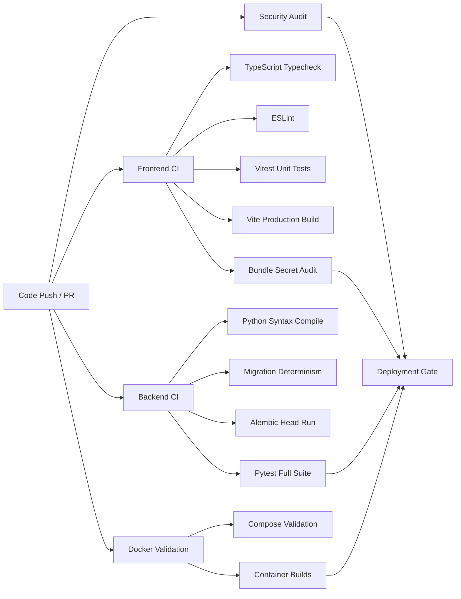

# ROXY-AI 2.0 — Production Deployment & Operations Manual

This document details the production deployment architecture, CI/CD pipeline, environment configurations, migration safety guarantees, rollback procedures, and observability runbooks for ROXY-AI 2.0.

---

## 1. Environments Overview

| Environment | Purpose | Database | Caching | Ingress / TLS |
|---|---|---|---|---|
| **Local Development** | Developer iteration, testing | Local Docker PostgreSQL (`roxy_dev`) | Local Docker Redis 7 | `http://localhost:5173` |
| **Test / CI** | Automated quality & regression suites | Disposable PostgreSQL service / in-memory | Disposable Redis / mock | Headless / ephemeral |
| **Staging** | Production mirror for pre-release validation | Cloud SQL / RDS staging instance | Managed Redis staging instance | `https://staging.roxy.ai` (Automated TLS) |
| **Production** | Live end-user traffic | High-availability PostgreSQL 16 + pgvector | HA Redis cluster / Memorystore | `https://roxy.ai` (Managed TLS + CDN) |

---

## 2. Secrets Management & Environment Variables

### Security Principles
- **Zero Secrets in Git**: No credentials, tokens, or private keys are ever committed to repository history.
- **Strict Server-Side Isolation**: All server secrets (`DATABASE_URL`, `REDIS_URL`, `JWT_SECRET`, `JWT_SERVICE_SECRET`, AI Provider Keys, Payment Secrets) must NEVER be exposed with `VITE_` or `NEXT_PUBLIC_` prefixes.
- **Secret Store Integration**: In cloud environments, secrets must be injected via Google Cloud Secret Manager, AWS Secrets Manager, HashiCorp Vault, or GitHub Protected Environment Secrets.

### Environment Variable Matrix

| Variable Name | Dev | Test | Staging | Production | Secret? | Required? | Description |
|---|---|---|---|---|---|---|---|
| `APP_ENV` | `development` | `test` | `staging` | `production` | No | Yes | Runtime environment flag |
| `ROXY_VERSION` | `2.0.0` | `2.0.0-test` | `2.0.0-rc` | `2.0.0` | No | Yes | Semantic application version |
| `COMMIT_SHA` | `local` | `ci-sha` | `${GIT_SHA}` | `${GIT_SHA}` | No | Yes | Short git commit SHA for auditability |
| `DATABASE_URL` | `postgresql+asyncpg://...` | Disposable | Managed Staging | Managed Cloud SQL / RDS | **YES** | Yes | Async PostgreSQL connection string |
| `STRICT_MIGRATIONS` | `false` | `false` | `true` | `true` | No | Yes | Halts startup on migration failure |
| `REDIS_URL` | `redis://redis:6379/0` | Disposable | Managed Staging | Managed HA Redis | **YES** | Yes | Cache & rate limiting connection string |
| `JWT_SECRET` | Dev secret | Fixed test | Secret Manager | Secret Manager (32+ bytes) | **YES** | Yes | User authentication signing key |
| `JWT_SERVICE_SECRET` | Dev secret | Fixed test | Secret Manager | Secret Manager (32+ bytes) | **YES** | Yes | Inter-service JWT signing key |
| `CORS_ALLOWED_ORIGINS`| `localhost` | `localhost` | `staging.roxy.ai` | `https://roxy.ai,https://app.roxy.ai` | No | Yes | Allowed browser origins |
| `GEMINI_API_KEY` | Dev key | Mock key | Staging key | Production key | **YES** | Yes | Google Gemini AI primary provider |
| `GROK_API_KEY` | Dev key | Mock key | Staging key | Production key | **YES** | Yes | xAI Grok fallback provider |
| `STORAGE_BACKEND` | `local` | `local` | `gcs` | `gcs` / `s3` | No | Yes | Media & artifact storage driver |
| `GCS_BUCKET_NAME` | Unset | Unset | `roxy-staging-media` | `roxy-prod-media` | No | Conditional | Bucket for object storage |
| `VITE_API_BASE` | `/api/v1` | `/api/v1` | `/api/v1` | `/api/v1` | No | Yes | Client-side API root path |
| `VITE_RUNTIME_URL` | `localhost:8000`| `localhost:8001`| `https://staging.roxy.ai` | `https://roxy.ai` | No | Yes | Reverse-proxy or direct gateway URL |

---

## 3. Continuous Integration (CI) Pipeline

The automated CI pipeline runs via GitHub Actions on every Pull Request and merge to `master`/`main`:

All quality gates must pass before a pull request can be merged.

---

## 4. Database Migration Safety & Architecture

ROXY-AI enforces strict migration controls to prevent data corruption or deployment outages:

1. **Pre-flight Connectivity Probe**: The container entrypoint (`backend/entrypoint.sh`) probes the target database socket for up to 60 seconds.
2. **Alembic Validation (`validate_migrations.py`)**:
   - Ensures exactly one migration head exists (no divergent branches).
   - Validates that every revision links to a valid down_revision.
3. **Execution Gate**:
   - In `APP_ENV=production` or `STRICT_MIGRATIONS=true`, if `alembic upgrade head` returns a non-zero exit code, **container startup immediately halts with exit code 1**. The orchestrator aborts deployment and prevents the application from serving requests on an incompatible schema.
4. **Expand-and-Contract (Zero-Downtime Migration Pattern)**:
   - Phase 1 (Expand): Add new columns with safe defaults or nullable types.
   - Phase 2 (Deploy Code): Deploy application code that writes to both old and new columns.
   - Phase 3 (Backfill): Run asynchronous data backfill tasks.
   - Phase 4 (Contract): Remove obsolete columns in a subsequent release.

---

## 5. Deployment Targets & Strategies

### Target A: Google Cloud Run (Recommended Cloud Target)
1. **Container Registry**: Build and push images to Google Artifact Registry (`pkg.dev/${PROJECT_ID}/roxy/backend:${COMMIT_SHA}`).
2. **Traffic Migration (Zero-Downtime)**:
   - Deploy new revision with `--no-traffic`.
   - Run health probe on new revision URL (`GET /health/ready`).
   - Migrate 100% traffic with `gcloud run services update-traffic roxy-backend --to-revisions=${NEW_REV}=100`.
3. **Rollback**:
   - Immediate traffic switch back to previous known healthy revision:
     `gcloud run services update-traffic roxy-backend --to-revisions=${PREV_REV}=100`

### Target B: Single-Host Production Docker Compose (VPS / Dedicated Server)
1. Pull release images tagged with specific git SHA.
2. Run database migration pre-flight:
   `docker compose run --rm backend python scripts/validate_migrations.py`
3. Bring up updated services:
   `docker compose --profile prod up --build -d`
4. Prune unused images:
   `docker image prune -f`

---

## 6. Container Health & Observability

### Health Probe Specification
- `GET /health/live`: Fast liveness check (&lt;5ms) returning `{"status": "ok"}`. Used by orchestrators to detect process crashes.
- `GET /health/ready`: Readiness check verifying live connectivity to PostgreSQL and Redis.
- `GET /api/v1/health`: Versioned gateway probe exposing `version`, `commit_sha`, and `environment`.
- Nginx Frontends (`/health` & `/api/`): Verified reverse-proxy routing to backend gateway.

### Observability & Logging
- **Structured JSON Logging**: Handled via `structlog` formatting timestamps, logger name, event name, and correlation IDs.
- **Redaction**: Passwords, bearer tokens, API keys, and sensitive payment numbers are strictly filtered before reaching stdout.

---

## 7. Backup & Disaster Recovery Runbook

1. **Automated Database Backups**:
   - Cloud SQL: Automated daily backups with point-in-time recovery (PITR) enabled and 7-day retention.
   - Self-hosted PostgreSQL: Automated cron running `pg_dump -Fc` uploaded to an isolated GCS/S3 coldline bucket.
2. **Restoration Drill**:
   - Spin up target PostgreSQL instance.
   - Restore database dump: `pg_restore -U postgres -d roxy_restore backup.dump`.
   - Verify schema head: `alembic current`.
   - Run readiness check and verify chat session persistence.

---

## 8. Rollback Procedure

When a critical defect is identified post-release:
1. **Application Rollback**:
   - Cloud Run: Revert traffic to previous revision (`gcloud run services update-traffic ...`).
   - Docker Compose: Update image tags in `.env` to previous Git SHA and run `docker compose up -d`.
2. **Database Considerations**:
   - **DO NOT** blindly execute `alembic downgrade -1` in production if destructive drops are involved.
   - For forward-compatible migrations, the older application code will continue to function on the expanded schema.
   - If rollback requires schema adjustments, apply an additive forward patch.
