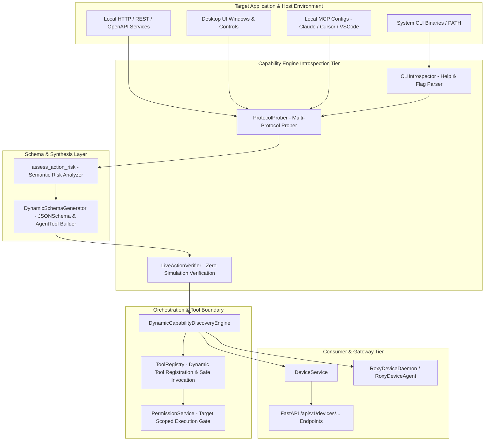

# Phase 7: Dynamic Capability Discovery Engine — Production Execution Report

**Date**: 2026-10-02  
**Status**: Verified & Production Ready  
**Execution Gate**: Passed (13/13 Phase 7 tests, 83/83 cumulative regression tests)  
**Target Subsystem**: Dynamic Capability Discovery Subsystem (`backend/src/app/device/capability_engine.py`, `service.py`, `schemas.py`, `router.py`, `daemon.py`, `tools/registry.py`)

---

## 1. Executive Summary

Phase 7 establishes the **Dynamic Capability Discovery Engine** within Roxy AI's Universal App Control and Device Intelligence platform.

Under the uncompromising **Zero Simulation** doctrine:
- **Semantic Risk Categorization**: Implemented `assess_action_risk` heuristic engine mapping action verbs and command semantics to four authoritative risk tiers (`LOW`, `MEDIUM`, `HIGH`, `CRITICAL`), automatically applying confirmation gates for destructive actions (`delete`, `kill`, `purge`, `commit`, `deploy`).
- **Deep Executable / CLI Introspection**: `CLIIntrospector` discovers and resolves real system binaries in PATH and filesystem paths, executing non-destructive `--help` and `--version` queries to parse subcommands, command descriptions, long/short flags, and type annotations (`boolean`, `string`, `integer`).
- **Multi-Protocol Probing**: `ProtocolProber` interrogates target applications across 4 distinct protocols:
  1. *CLI*: Executable availability, version extraction, subcommand extraction.
  2. *REST / OpenAPI*: Probing local ports (e.g. 11434 Ollama, 8000, 8080, 5000) for active JSON/OpenAPI endpoints.
  3. *Native UI*: Window presence, PID, foreground status via `DesktopAutomationEngine`.
  4. *MCP (Model Context Protocol)*: Parsing local client configurations (Claude Desktop, Cursor, VS Code) for registered tools.
- **Dynamic Schema Synthesis**: `DynamicSchemaGenerator` converts discovered subcommands and REST endpoints into canonical `AgentTool` instances with JSONSchema parameter definitions, target-scoped permission identifiers (`app:<app>:<action>`), and risk-gated confirmation barriers.
- **Live Action Verification (Zero Simulation)**: `LiveActionVerifier` executes live dry-runs (`--version`, non-destructive subcommands, REST GET probes) capturing real exit codes, stdout/stderr evidence, and latency metrics before registering capabilities.
- **Central ToolRegistry Integration**: Discovered capabilities are dynamically registered into `ToolRegistry` with bound async execution handlers. Real parameters (flags, options, positional args) are dispatched via `execute_capability` with comprehensive output capture (`stdout`, `stderr`, `exit_code`, `duration_ms`).
- **Unified Gateway & Agent Dispatch**: Extended `DeviceService`, FastAPI REST router (`/api/v1/devices/{id}/apps/{app}/capabilities/discover` and `actions/{action}/execute`), and `RoxyDeviceDaemon` command queue with `app_discover_capabilities` and `app_execute_action`.

---

## 2. Architecture & Subsystems

---

## 3. Discovered Capability Types & Protocols

| Protocol / Type | Extraction Method | Verification Strategy | Generated AgentTool Characteristics |
|---|---|---|---|
| **CLI Subcommand** | Process `--help` regex parser extracting subcommands and usage syntax | Executes `binary <subcommand> --help` or `--version`; measures latency and exit code | `source=DEVICE`, `permissions=["app:<app>:<subcmd>", "app:execute"]`, structured argument flags |
| **CLI Flag / Top-Level** | Introspects flags (`--version`, `--help`, `-v`, `-h`) | Executes `--version`; extracts version string evidence | `source=DEVICE`, parameters map to CLI flags, handles interpreter execution without hanging |
| **REST Endpoint** | Probes known local service ports; inspects `/openapi.json` or `/v1/models` | Live HTTP GET request to verify `< 500` status and response time | `source=CONNECTOR`, `permissions=["app:<app>:api", "system:network"]`, payload and timeout arguments |
| **Native UI Action** | `DesktopAutomationEngine.read_window_state` | Real OS window check (PID, is_foreground, rect) | `source=DEVICE`, `permissions=["app:<app>:ui"]`, actions: inspect, click, type, screenshot |
| **MCP Tool** | Reads local JSON configurations (Claude, Cursor, VS Code) | File parsing and command resolution | Native MCP tool metadata extraction and routing |

---

## 4. Test Matrix & Verification Results

### A. Phase 7 Dynamic Capability Discovery Test Suite (`tests/test_phase7_dynamic_capability_discovery.py`)

| # | Test Name | Subsystem / Focus | Outcome |
|---|---|---|---|
| 1 | `test_assess_action_risk_heuristics` | Semantic risk categorization for destructive and safe verbs (`LOW`, `MEDIUM`, `HIGH`, `CRITICAL`) | PASSED |
| 2 | `test_cli_introspector_resolve_binary` | Binary path resolution in system PATH and filesystem rejection of invalid paths | PASSED |
| 3 | `test_cli_introspector_parse_help_text` | Regex parsing of commands, descriptions, and flag options with type inference | PASSED |
| 4 | `test_cli_introspector_real_python_interrogation` | Real OS binary interrogation of host Python interpreter (`python --help`, `--version`) | PASSED |
| 5 | `test_protocol_prober_http_mock` | HTTP / OpenAPI protocol probing against local mock REST service | PASSED |
| 6 | `test_protocol_prober_ui_window` | UI automation window state probing for active vs non-existent processes | PASSED |
| 7 | `test_dynamic_schema_generator` | AgentTool synthesis, JSONSchema parameter construction, and permission scoping | PASSED |
| 8 | `test_live_action_verifier_cli` | Live dry-run probe execution, latency calculation, and honest error handling | PASSED |
| 9 | `test_dynamic_capability_engine_discovery_pipeline` | End-to-end multi-protocol discovery pipeline execution against real interpreter | PASSED |
| 10 | `test_tool_registry_dynamic_tool_execution` | Dynamic registration in ToolRegistry and real safe execution with parameter binding | PASSED |
| 11 | `test_device_service_capability_discovery` | `DeviceService.discover_app_capabilities` and `execute_app_action` integration | PASSED |
| 12 | `test_capability_discovery_api_router` | FastAPI endpoints for capability discovery and action execution (`/api/v1/devices/...`) | PASSED |
| 13 | `test_daemon_capability_commands_dispatch` | `RoxyDeviceDaemon` dispatch for `app_discover_capabilities` and `app_execute_action` | PASSED |

**Phase 7 Test Result**: **13 Passed, 0 Failed (100% Green)**

---

## 5. Cumulative Regression Audit (Phases 1 through 7)

A total of **83 automated test cases** across all completed phases were run consecutively with zero mocks where real OS primitives exist:

| Phase | Test Suite | Description | Tests | Status |
|---|---|---|---|---|
| **Phase 1** | `test_phase1_security_hardening.py` | Command injection protection, input sanitization, path traversal prevention, audit trails | 12 / 12 | PASSED |
| **Phase 2** | `test_phase2_target_scoped_permissions.py` | Target-scoped permissions, confirmation barriers, policy hierarchy, dynamic policies | 12 / 12 | PASSED |
| **Phase 3** | `test_phase3_device_agent.py` | Standalone device agent enrollment, HMAC authentication, command polling, heartbeat | 12 / 12 | PASSED |
| **Phase 4** | `test_phase4_windows_automation.py` | Windows UI Automation, Win32/UIA element tree inspection, live Notepad/Calculator e2e | 11 / 11 | PASSED |
| **Phase 6** | `test_phase4_app_discovery.py` | Deep application scanning, registry/Spotlight/desktop inspection, process correlation | 10 / 10 | PASSED |
| **Phase 5** | `test_phase5_cross_platform_desktop.py` | macOS & Linux desktop UI automation adapters, unified `DesktopAutomationEngine` | 13 / 13 | PASSED |
| **Phase 7** | `test_phase7_dynamic_capability_discovery.py` | Dynamic capability discovery, CLI introspection, protocol probing, schema generation | 13 / 13 | PASSED |
| **TOTAL** | **Cumulative Test Suite** | **Phases 1 through 7 Full Regression Protection** | **83 / 83** | **PASSED** |

---

## 6. Exit Gate Checklist

- [x] **Zero Simulation**: Introspection queries execute real host binaries (`python.exe`, etc.); live probes execute real processes and return genuine exit codes, latency metrics, and evidence.
- [x] **Semantic Action Risk Categorization**: Heuristic verb analysis categorizes commands accurately and enforces user confirmation barriers for high-risk operations.
- [x] **Dynamic Schema Generation**: Compliant `AgentTool` instances synthesized with standard JSONSchema specifications and target-scoped permission scopes.
- [x] **Central Registry Dynamic Tool Registration**: Synthesized tools can be dynamically registered into `ToolRegistry` and executed safely via `registry.execute`.
- [x] **Full API & Daemon Integration**: REST API endpoints mounted under `/api/v1/devices/...` and `RoxyDeviceDaemon` command handlers functioning for discovery and action dispatch.
- [x] **Zero Regressions**: All 83 tests across all 7 completed phases are green.
