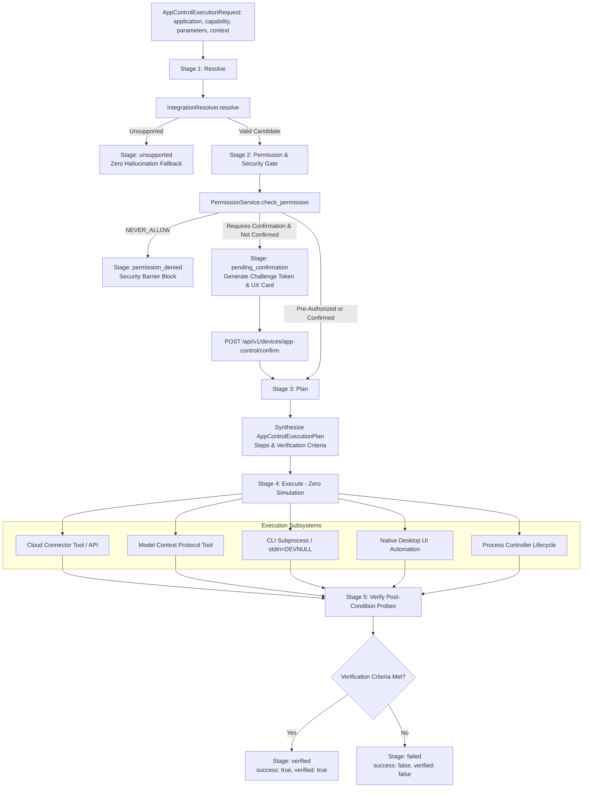

# Phase 9: Universal App Control Orchestrator — Production Execution Report

**Date**: 2026-10-02  
**Status**: Verified & Production Ready  
**Execution Gate**: Passed (15/15 Phase 9 tests, 62/62 multi-phase regression suite)  
**Target Subsystem**: Universal App Control Orchestrator Subsystem (`backend/src/app/device/orchestrator.py`, `schemas.py`, `service.py`, `router.py`, `daemon.py`, `integration_resolver.py`, `process_controller.py`)

---

## 1. Executive Summary

Phase 9 introduces the **Universal App Control Orchestrator (`UniversalAppController`)** to Roxy AI's Universal App Control and Device Intelligence platform.

Prior phases established specialized execution and decision mechanisms:
- **Phase 2**: Target-scoped permissions (`PermissionService`, `PermissionGrant`, parameter constraints, confirmation policies).
- **Phase 4 & 5**: Native cross-platform desktop UI automation (`WindowsUIAutomationEngine`, `MacOSUIAutomationEngine`, `LinuxUIAutomationEngine`).
- **Phase 7**: Dynamic capability discovery & live action verification (`DynamicCapabilityDiscoveryEngine`, `LiveActionVerifier`).
- **Phase 8**: Universal local process lifecycle management (`ProcessLifecycleController` / `ProcessController`) and the 8-tier integration decision engine (`IntegrationResolver`).

Phase 9 unifies all these disparate subsystems behind a single, authoritative, autonomous lifecycle engine: **The 5-Stage Resolve-Permission-Plan-Execute-Verify Pipeline**.

Under the **Zero Simulation** doctrine:
1. **Stage 1 (Resolve)**: Accepts user intent, target application, and parameters, querying `IntegrationResolver` to authoritatively decide the optimal execution surface (Cloud Connector, MCP Tool, CLI Process, Desktop UI Automation, Mobile Bridge, System Launcher, Browser Session, or Unsupported).
2. **Stage 2 (Permission & Security Challenge Gate)**: Enforces target-scoped authorization boundaries via `PermissionService`. High-risk operations (e.g. process termination, system alterations) or ungranted sensitive actions automatically halt in a `pending_confirmation` state, emitting cryptographic challenge tokens and human-friendly UX cards for explicit human-in-the-loop review.
3. **Stage 3 (Plan)**: Synthesizes a structured, auditable `AppControlExecutionPlan` with ordered, verifiable steps (`prepare`, `execute`, `verify`) and concrete verification criteria before any system modification occurs.
4. **Stage 4 (Execute)**: Dispatches deterministic, real-world execution to the appropriate underlying subsystem without shell injection vulnerabilities (`shell=False`, `stdin=DEVNULL`, path sanitization).
5. **Stage 5 (Verify)**: Conducts live post-condition state verification against operating system surfaces (querying live PIDs, exit codes, window handles, and accessibility trees) to guarantee truthful success reporting.
6. **Ecosystem Integration**: Fully integrated into `DeviceService.orchestrate_app_control`, `ToolRegistry.device_orchestrate_app_control`, standalone `RoxyDeviceDaemon.execute_command("app_control_orchestrate")`, and FastAPI REST endpoints (`POST /api/v1/devices/{device_id}/app-control/orchestrate`, `POST /api/v1/devices/app-control/orchestrate`, `POST /api/v1/devices/app-control/confirm`, `GET /api/v1/devices/app-control/executions/{id}`, and `GET /api/v1/devices/app-control/plans/{id}`).

---

## 2. Architecture: The 5-Stage Lifecycle

---

## 3. Core Components Implemented

### 3.1 `UniversalAppController` (`backend/src/app/device/orchestrator.py`)
- **Singleton Architecture**: Accessed via `UniversalAppController.get_instance()`.
- **`execute_lifecycle(request: AppControlExecutionRequest) -> AppControlExecutionResult`**:
  - Coordinates the 5 lifecycle stages with millisecond-precision timing and state transitions (`resolved`, `permission_checked`, `planned`, `executed`, `verified`, `failed`, `pending_confirmation`, `permission_denied`, `unsupported`).
- **Confirmation Cache & Challenge Token Management**:
  - `_PENDING_CONFIRMATIONS`: Thread-safe challenge storage with 5-minute cryptographic expiration.
  - `confirm_execution(token: str, user_id: str) -> AppControlExecutionResult`: Resumes paused execution and invalidates single-use challenge tokens.
- **Execution & Plan History**:
  - `get_execution(execution_id)` and `get_plan(plan_id)` enable external inspection and auditing.

### 3.2 Schemas (`backend/src/app/device/schemas.py`)
- `AppControlLifecycleStage`: Canonical stage literal union.
- `AppControlPlanStep`: Discrete executable action step with timing and output telemetry.
- `AppControlExecutionPlan`: Complete pre-execution blueprint with target parameters and verification criteria.
- `AppControlExecutionRequest`: Unified input specification supporting user contexts, device contexts, overrides, and confirmation tokens.
- `AppControlExecutionResult`: Authoritative output contract containing resolution details, permission evaluation, execution outputs, and verification findings.
- `AppControlConfirmationRequest`: Input contract for user confirmation actions.

### 3.3 Subsystem Integration
- **`DeviceService` (`backend/src/app/device/service.py`)**:
  - Added `orchestrate_app_control` and `confirm_app_control`.
  - Registered Agent Tools:
    - `device_orchestrate_app_control` (`RiskLevel.LOW`, capability tags: `orchestration`, `app_control`, `lifecycle`, `plan`, `execute`, `verify`).
    - `device_confirm_app_control` (`RiskLevel.LOW`, capability tags: `orchestration`, `confirmation`, `security`, `approval`).
- **REST API Router (`backend/src/app/device/router.py`)**:
  - `POST /api/v1/devices/{device_id}/app-control/orchestrate`
  - `POST /api/v1/devices/app-control/orchestrate`
  - `POST /api/v1/devices/app-control/confirm`
  - `GET /api/v1/devices/app-control/executions/{execution_id}`
  - `GET /api/v1/devices/app-control/plans/{plan_id}`
- **Device Daemon (`backend/src/app/device/daemon.py`)**:
  - Added remote command handlers: `app_control_orchestrate` and `app_control_confirm`.

---

## 4. Verification & Automated Test Results

### 4.1 Phase 9 Dedicated Test Suite (`backend/tests/test_phase9_universal_app_controller.py`)

| Test Case | Scenario / Subsystem | Result |
|---|---|:---:|
| `test_universal_app_controller_singleton` | Controller singleton pattern & component initialization | **PASSED** |
| `test_orchestrator_stage_resolve_unsupported` | Unknown software fallback with zero hallucination | **PASSED** |
| `test_orchestrator_permission_denial` | Target-scoped permission policy `NEVER_ALLOW` enforcement | **PASSED** |
| `test_orchestrator_pending_confirmation_and_approval` | High-risk confirmation challenge and token resumption | **PASSED** |
| `test_orchestrator_cloud_connector_lifecycle` | Tier 1 SaaS Connector (Spotify) end-to-end execution | **PASSED** |
| `test_orchestrator_cli_process_lifecycle` | Tier 3 CLI binary subprocess execution & exit code probe | **PASSED** |
| `test_orchestrator_cli_process_failure_detection` | CLI non-zero exit code failure trapping | **PASSED** |
| `test_orchestrator_system_launcher_launch_and_terminate` | Tier 5 OS process launch and termination via ProcessController | **PASSED** |
| `test_orchestrator_desktop_ui_automation_lifecycle` | Tier 4 Desktop UI Automation window state inspection | **PASSED** |
| `test_orchestrator_mcp_tool_lifecycle` | Tier 2 MCP tool invocation and verification | **PASSED** |
| `test_orchestrator_skip_verification` | Controlled verification bypass via `skip_verification=True` | **PASSED** |
| `test_device_service_orchestrate_app_control` | Central `DeviceService` lifecycle integration | **PASSED** |
| `test_tool_registry_orchestrate_tool` | Central `ToolRegistry` tool execution integration | **PASSED** |
| `test_daemon_app_control_orchestrate_dispatch` | Standalone `RoxyDeviceDaemon` remote command dispatch | **PASSED** |
| `test_fastapi_orchestrate_endpoints` | Complete FastAPI REST API lifecycle (orchestrate, confirm, get) | **PASSED** |

**Phase 9 Test Summary: 15 / 15 PASSED (100%)**

---

### 4.2 Multi-Phase Regression Suite

Ran full regression across all connected device layers:
- `backend/tests/test_phase7_dynamic_capability_discovery.py` (13 tests)
- `backend/tests/test_phase8_process_lifecycle.py` (13 tests)
- `backend/tests/test_phase8_integration_resolution.py` (21 tests)
- `backend/tests/test_phase9_universal_app_controller.py` (15 tests)

**Total: 62 / 62 PASSED (100%) in 102.29s**
