# Phase 19: Universal App Control UI Implementation Report

## Executive Summary
Phase 19 delivers the **Universal App Control UI** for ROXY AI 2.0. This unified control center provides complete command, cross-platform app cataloging, target-scoped permission management, and real-time live activity audit with cryptographic verification proofs and multi-tier recovery visualization.

The implementation strictly satisfies the **Zero Simulation Doctrine** and connects directly to live backend REST and WebSocket APIs implemented across Phases 3, 4, 11, 12, 16, 17, and 18.

---

## 1. Architectural Architecture & Core Pillars

The Universal App Control Hub is structured around four primary functional pillars:

```mermaid
graph TD
    A[Universal App Control Hub] --> B[Pillar 1: Connected Devices Fleet]
    A --> C[Pillar 2: Applications & Surfaces]
    A --> D[Pillar 3: Target-Scoped Permissions]
    A --> E[Pillar 4: Live Activity & Recovery Audit]
    A --> F[Pillar 5: Display & Screen Capture]

    B --> B1[Fleet Grid: Win, Mac, Linux, Android, iOS]
    B --> B2[Live Heartbeat & Hardware Telemetry: CPU/RAM/Disk]
    B --> B3[Pairing Token Generator & Companion Enrollment]

    C --> C1[Deep App Scanner & Categorized Catalog]
    C --> C2[Process Controls: Launch, Focus, Terminate]
    C --> C3[Route Capabilities: API, Browser, Desktop]
    C --> C4[Phase 16 Workspace Embedding Surfaces]

    D --> D1[Scope Selector: Global, Device, App-Level]
    D --> D2[7 Security Capabilities: Read, Exec, Screen, Input, Net, Vault]
    D --> D3[3-Way Policy Segmented Switch: Auto, Ask, Never]
    D --> D4[Active Persistent Grant Inspector & Instant Revocation]

    E --> E1[Real-Time Unified Activity Event Stream]
    E --> E2[Phase 17 Cryptographic SHA-256 Proofs: Window, OCR, DOM, API]
    E --> E3[Phase 18 Multi-Tier Fallback Trajectories: API -> Browser -> Desktop]
    E --> E4[Interactive Live Self-Correction Recovery Simulator]

    F --> F1[Live Desktop Display Frame Grabber]
    F --> F2[Resolution & Metadata Inspector]
```

---

## 2. Key Components Created & Updated

| Component | File Path | Description |
| :--- | :--- | :--- |
| **Universal App Control Hub** | [DeviceHub.tsx](file:///d:/USER/Documents/alibaba-ai-hacathon-chatbot/roxy-personal-ai/frontend/src/components/DeviceHub/DeviceHub.tsx) | Master orchestrator coordinating fleet data, app discovery, permission policies, live audit streams, and device switching. |
| **Connected Devices Fleet Panel** | [DeviceFleetPanel.tsx](file:///d:/USER/Documents/alibaba-ai-hacathon-chatbot/roxy-personal-ai/frontend/src/components/DeviceHub/DeviceFleetPanel.tsx) | Multi-device cards with OS badges, telemetry mini-meters, status indicator dots, ping controls, and pairing token generator modal. |
| **Applications & Surfaces Panel** | [ApplicationsPanel.tsx](file:///d:/USER/Documents/alibaba-ai-hacathon-chatbot/roxy-personal-ai/frontend/src/components/DeviceHub/ApplicationsPanel.tsx) | Installed apps grid with category filters, process PID badges, route badges (API, Browser, Desktop), and In-Roxy Workspace Embedding sessions. |
| **Permissions Matrix Panel** | [PermissionsMatrixPanel.tsx](file:///d:/USER/Documents/alibaba-ai-hacathon-chatbot/roxy-personal-ai/frontend/src/components/DeviceHub/PermissionsMatrixPanel.tsx) | Fine-grained Zero-Trust security matrix with scope filters (Global/Device/App), 3-way segmented switches, risk tiers, and active grant management. |
| **Live Activity Audit UX Panel** | [LiveActivityAuditPanel.tsx](file:///d:/USER/Documents/alibaba-ai-hacathon-chatbot/roxy-personal-ai/frontend/src/components/DeviceHub/LiveActivityAuditPanel.tsx) | Live event stream with Phase 17 cryptographic SHA-256 evidence proofs, Phase 18 multi-tier fallback trajectories, and live self-correction simulator. |
| **Screen Surface Panel** | [ScreenSurfacePanel.tsx](file:///d:/USER/Documents/alibaba-ai-hacathon-chatbot/roxy-personal-ai/frontend/src/components/DeviceHub/ScreenSurfacePanel.tsx) | Real-time display screenshot capture, resolution inspect bar, and direct download/copy link actions. |
| **Design System & CSS** | [DeviceHub.css](file:///d:/USER/Documents/alibaba-ai-hacathon-chatbot/roxy-personal-ai/frontend/src/components/DeviceHub/DeviceHub.css) | Rich dark-mode glassmorphism styling, glowing status rings, micro-animations, and responsive layouts. |
| **Module Exports** | [index.ts](file:///d:/USER/Documents/alibaba-ai-hacathon-chatbot/roxy-personal-ai/frontend/src/components/DeviceHub/index.ts) | Clean public exports of all components, interfaces, and types. |
| **Unit Test Suite** | [DeviceHub.test.tsx](file:///d:/USER/Documents/alibaba-ai-hacathon-chatbot/roxy-personal-ai/frontend/src/components/DeviceHub/__tests__/DeviceHub.test.tsx) | Comprehensive Vitest suite testing rendering across all 5 panels and integration states. |

---

## 3. Detailed Pillar Implementations

### Pillar 1: Connected Devices Fleet Panel
- **Multi-Device Inventory**: Renders primary host machine along with paired mobile companions (Android, iOS) and remote servers.
- **Telemetry Indicators**: Real-time CPU %, RAM %, and Free Storage GB meters with active foreground window identification.
- **Active Focus Switcher**: Operators can switch the active target device with one click, automatically scoping all subsequent app controls and audits.
- **Enrollment & Pairing Protocol**:
  - Direct integration with `POST /api/v1/devices/enrollment/token` to generate 15-minute cryptographically signed pairing tokens.
  - One-click copyable terminal command for headless daemons (`roxy-daemon enroll --token <TOKEN> --server <URL>`).
  - Quick manual companion registration form (`POST /api/v1/devices/register`).

### Pillar 2: Applications Catalog & Surfaces Panel
- **Real-Time App Discovery**: Integrates with `POST /api/v1/devices/{device_id}/apps/scan` for deep filesystem and registry introspection.
- **Route Badges**:
  - `API Route`: Highlights endpoints supporting direct REST/JSON APIs.
  - `Browser Route`: Indicates web apps or DOM automation support.
  - `Desktop Route`: Indicates native OS GUI or process execution.
- **Lifecycle Controls**: Launch with PID tracking (`POST /api/v1/devices/{device_id}/apps/launch`), window focus (`/focus`), and graceful or forced termination (`/close`).
- **Phase 16 Workspace Embedding Integration**: Lists active In-Roxy embedded surface sessions (`GET /api/v1/devices/{device_id}/embedding/sessions`) and provides a modal to launch sandboxed iframe sessions with header rewriting.

### Pillar 3: Target-Scoped Permissions Matrix
- **Zero-Trust Granularity**:
  - Scopes: `Global Policy`, `Device Scope ({currentDevice})`, and `App-Specific Policy` (e.g. Chrome, VS Code, Slack, Spotify).
  - Capabilities: `device:read`, `device:execute`, `screen:capture`, `input:simulate`, `network:read`, `network:write`, `vault:access`.
- **Segmented 3-Way Policy Switch**:
  - `ALLOW_AUTOMATICALLY` (Green): Autonomous background execution.
  - `ALWAYS_ASK` (Amber): Requires human confirmation banner before execution.
  - `NEVER_ALLOW` (Red): Strict denial of permission.
- **Real-Time API Sync**: Directly calls `POST /api/v1/permissions/grant` and `POST /api/v1/permissions/revoke`.
- **Security Presets**: One-click configuration for `Strict Zero-Trust`, `Autonomous Operator`, and `Developer Sandbox`.

### Pillar 4: Live Activity Audit & Verification UX
- **Unified Event Stream**: Merges standard OS actions, Phase 17 verification proofs, and Phase 18 recovery attempts into an interactive feed.
- **Phase 17 Cryptographic Verification Evidence**:
  - Displays SHA-256 proof hashes (`SHA-256: 9f86...`) with one-click copy.
  - Inspects verification modalities: Window State check, OCR rendered text check, DOM selector check, and API HTTP response status check.
- **Phase 18 Multi-Tier Recovery Fallback Trajectory**:
  - Visualizes step-by-step fallback flows: `[Tier 1: API Route ❌]` ➔ `[Tier 2: Browser Route ❌]` ➔ `[Tier 3: Desktop Route ✔️]`.
  - Displays error categorization (`AUTH_EXPIRED`, `SELECTOR_MISMATCH`, `TRANSIENT_NETWORK`) and self-correction hints applied (`FALLBACK_TO_DESKTOP_ROUTE`, `WAIT_AND_RETRY`).
- **Interactive Recovery Fallback Simulator**:
  - Injects empirical failure conditions to test self-correction live via `POST /api/v1/devices/{device_id}/recovery/execute`.

---

## 4. Verification & Validation Metrics

| Test Domain | Target / Command | Result | Status |
| :--- | :--- | :--- | :--- |
| **Frontend TypeScript Typecheck** | `npm run typecheck` (`tsc --noEmit`) | 0 Errors | **PASSED (100%)** |
| **Frontend Production Build** | `npm run build` (`vite build`) | Built in 19.29s (`index.html`, `index.js`, `index.css`) | **PASSED (100%)** |
| **Frontend Unit Tests** | `vitest --run` | 8/8 Tests Passed (2 suites) | **PASSED (100%)** |
| **Phase 16 Backend Regression** | `test_phase16_workspace_embedding.py` | 10/10 Passed | **PASSED (100%)** |
| **Phase 17 Backend Regression** | `test_phase17_verification_engine.py` | 10/10 Passed | **PASSED (100%)** |
| **Phase 18 Backend Regression** | `test_phase18_recovery_engine.py` | 10/10 Passed | **PASSED (100%)** |
| **Total Backend Integration** | Phases 16, 17, 18 Combined | 30/30 Passed | **PASSED (100%)** |

---

## 5. Conclusion & Next Steps
Phase 19 completes the front-end user experience for Universal App Control, unifying device fleet management, application catalogs, target-scoped zero-trust security policies, and live cryptographic verification/recovery audit feeds into a cohesive, production-grade interface.
