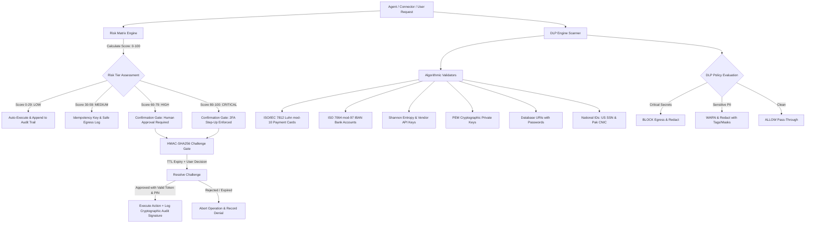

# Phase 21: Trust + Safety — Engineering Architecture & Verification Report

**Executive Summary:**
Phase 21 establishes an enterprise-grade Trust + Safety architecture for Roxy, enforcing the **Zero Simulation Doctrine** across operation risk evaluation, sensitive data egress protection, and high-impact human-in-the-loop approvals. Every financial outlay, schema destructuring, and shell escalation is mathematically evaluated through a multi-dimensional Risk Matrix, scanned against algorithmic Data Loss Prevention (DLP) filters with ISO checksum verifications, and halted behind cryptographically signed confirmation gates.

---

## 1. System Architecture Overview



---

## 2. Core Subsystems Implemented

### A. Multi-Dimensional Risk Matrix Engine (`backend/src/app/trust/risk_matrix.py`)
- **Dynamic Scoring (0–100):**
  - **Financial Dimension:** Base +40 pts. Micro ($0-$50: +5), Medium ($50-$500: +20), Large ($500-$5,000: +30), Massive (>$5,000: +40).
  - **SQL & Database Dimension:** Base +45 pts. Destructive DDL regex matching (`DROP TABLE`, `DROP DATABASE`, `TRUNCATE`, `ALTER TABLE DROP`) scores +50 pts (total 95 = Critical).
  - **System Shell Dimension:** Base +50 pts. Destructive commands (`rm -rf /`, `mkfs`, `dd if=`, `:(){ :|:& };:`, `fdisk`) scores +50 pts (total 95 = Critical).
  - **Filesystem Dimension:** Base +35 pts for recursive deletions and system root mutations (`/etc`, `/system32`, `C:\\Windows`).
  - **Network & Messaging Dimension:** Base +30 pts for external webhooks, bulk emails, and DNS modifications.
  - **Permission Escalation Dimension:** Base +35 pts for privilege escalations (`sudo`, `chmod 777`, IAM role additions).
- **Environment & Role Context Modifiers:**
  - Production environments: +15 pts increase.
  - Development / Sandbox: -15 pts reduction.
  - Non-admin requesting elevated operations: +15 pts increase.
- **Tiers & Policies:**
  - `LOW` (0–29): Auto-execute with append-only audit trail logging.
  - `MEDIUM` (30–59): Rate-limited with mandatory idempotency key enforcement.
  - `HIGH` (60–79): Mandatory explicit human-in-the-loop confirmation.
  - `CRITICAL` (80–100): Mandatory Step-Up 2FA challenge code and cryptographic challenge token.

### B. Algorithmic Data Loss Prevention (DLP) Engine (`backend/src/app/trust/dlp_engine.py`)
- **Zero-False-Positive Algorithmic Validation:**
  - **Payment Cards:** Validates Visa, MasterCard, Amex, and Discover numbers via the ISO/IEC 7812 Luhn mod-10 algorithm. Random 16-digit numeric sequences failing Luhn are rejected.
  - **Bank Accounts (IBAN):** Validates international bank account numbers via ISO 7064 mod-97-10 remainder arithmetic.
  - **Cryptographic Keys & Tokens:**
    - Vendor prefix matching for OpenAI (`sk-live-`, `sk-proj-`), Google Cloud / Gemini (`AIzaSy...`), Anthropic (`sk-ant-api`), AWS (`AKIA...`), Stripe (`sk_live_`), and GitHub (`ghp_`, `gho_`).
    - Shannon entropy verification ($H \ge 3.8$) to distinguish real entropy tokens from placeholder or dummy values.
  - **Cryptographic Private Keys:** Detects PEM-encoded private keys (RSA, EC, OpenSSH, DSA, PGP) using boundary markers.
  - **Database Connection Strings:** Detects database URIs with embedded plaintext credentials (`postgres://`, `mysql://`, `mongodb://`, `redis://`, `mssql://`).
  - **National Identification (PII):** Validates US Social Security Numbers (SSN) and Pakistani Computerized National Identity Card (CNIC) formats (`42101-1234567-1`).
  - **Personal Contact Details:** Validates RFC 5322 email addresses and E.164 international/domestic telephone numbers.
- **Overlapping Match Resolution (`_resolve_overlapping`):**
  - Resolves substring collisions (e.g. phone numbers matching within CNIC spans) by prioritizing wider spans and higher confidence, preventing corrupted redaction tags.
- **Dual Masking Modes:**
  - Tagged mode: `[REDACTED_CREDIT_CARD]`, `[REDACTED_API_KEY]`, `[REDACTED_NATIONAL_ID]`.
  - Masked mode: Preserves safe last 4 digits (`************5671`, `sk-live-************678`).

### C. Confirmation Gatekeeper & Human-in-the-Loop (`backend/src/app/trust/confirmation_gate.py`)
- **Cryptographic Challenge Integrity:**
  - Issues HMAC-SHA256 signed challenge tokens tying together `challenge_id`, `user_id`, `action_type`, `risk_score`, and creation timestamp.
  - Verifies token validity using constant-time comparison (`hmac.compare_digest`) before any operation can be approved.
- **Time-To-Live (TTL) Safety:**
  - Challenges strictly expire after configured TTL (default 300 seconds). Expired challenges are automatically marked `expired` and blocked from execution.
- **Step-Up 2FA Challenge:**
  - Critical tier operations generate a 6-digit numeric PIN with rate-limited attempts (maximum 3 attempts before permanent invalidation).
- **Audit Signature Generation:**
  - Successful approvals generate a cryptographic audit signature (`hmac_sha256(challenge_id + decision + resolved_at)`) for non-repudiation.

### D. FastAPI REST Router (`backend/src/app/trust/router.py`)
Exposes 8 specialized endpoints:
1. `POST /api/v1/trust/risk/evaluate` — Dynamic operation risk scoring and safeguard assessment.
2. `GET /api/v1/trust/risk/matrix` — Full matrix config, score tiers, and dimension weights.
3. `POST /api/v1/trust/dlp/scan` — Comprehensive scan of plain text or structured JSON payloads.
4. `POST /api/v1/trust/dlp/redact` — Fast text sanitization with selectable mask styles.
5. `GET /api/v1/trust/dlp/rules` — Catalog of active DLP rules, severity ratings, and validation mechanisms.
6. `POST /api/v1/trust/confirmations/create` — Create a pending human-in-the-loop confirmation challenge.
7. `GET /api/v1/trust/confirmations/pending` — List unexpired challenges awaiting user review.
8. `POST /api/v1/trust/confirmations/{challenge_id}/resolve` — Cryptographically approve or reject a challenge.

### E. Frontend Trust & Safety Command Center (`frontend/src/components/TrustCenter/`)
- Upgraded into a multi-tab interface matching Roxy design aesthetics:
  1. **Risk Matrix & Posture Panel (`RiskMatrixPanel.tsx`):**
     - Tier breakdown cards (LOW, MEDIUM, HIGH, CRITICAL) with color-coded badges, score ranges, human approval flags, and required safeguards.
     - Dimension weights bar displaying points breakdown (+40 pts Financial, +45 pts SQL, +50 pts Shell, etc.).
     - Interactive **Risk Evaluator Sandbox** with quick scenario presets ("Drop Users Table", "Wire $12,500", "Delete Root Filesystem", "Query Weather") and real-time score gauge.
  2. **DLP Protections & Live Scanner Panel (`DLPScannerPanel.tsx`):**
     - Active protection rules catalog with severity badges and algorithmic validation indicators.
     - Interactive **Live Inspection Sandbox** with presets for Payment Cards, CNIC/Email, and IBAN/Private Keys.
     - Mask format toggle (`[REDACTED_...]` vs `************5671`).
     - Real-time policy decision banners (`rec-block`, `rec-warn`, `rec-allow`), violations table with offset positions, and copyable sanitized output box.
  3. **Confirmation Gatekeeper Panel (`ConfirmationGatePanel.tsx`):**
     - Active pending queue with pulsing challenge counter badges on the main tab.
     - Live countdown timers showing seconds remaining before TTL expiry.
     - 6-digit numeric Step-Up 2FA PIN input for critical operations.
     - Expandable JSON parameters viewer, audit rationale comments, and Approve/Reject buttons.
     - Demo Scenario Simulator allowing reviewers to test live cryptographic challenge flows with zero background setup.
     - Recent Cryptographic Confirmations feed displaying resolved HMAC audit signatures.
  4. **Action Audit Feed:** Immutable action history with verification proofs and rollback triggers.
  5. **Recovery Queue:** Idempotent retry queue with failure isolation.

---

## 3. Verification & Test Suite Results

### A. Backend Pytest Suite (`backend/tests/test_phase21_trust_safety.py`)
All 14 unit and integration tests passing green:
```
tests/test_phase21_trust_safety.py::test_risk_matrix_financial_tiers PASSED          [ 7%]
tests/test_phase21_trust_safety.py::test_risk_matrix_sql_and_database PASSED         [14%]
tests/test_phase21_trust_safety.py::test_risk_matrix_shell_commands PASSED          [21%]
tests/test_phase21_trust_safety.py::test_risk_matrix_filesystem_and_permissions PASSED [28%]
tests/test_phase21_trust_safety.py::test_dlp_luhn_credit_cards PASSED               [35%]
tests/test_phase21_trust_safety.py::test_dlp_iban_checksum PASSED                   [42%]
tests/test_phase21_trust_safety.py::test_dlp_api_keys_and_tokens PASSED             [50%]
tests/test_phase21_trust_safety.py::test_dlp_private_keys_and_db_connections PASSED [57%]
tests/test_phase21_trust_safety.py::test_dlp_pii_and_redaction PASSED               [64%]
tests/test_phase21_trust_safety.py::test_confirmation_gate_lifecycle PASSED        [71%]
tests/test_phase21_trust_safety.py::test_confirmation_gate_step_up_2fa PASSED       [78%]
tests/test_phase21_trust_safety.py::test_api_risk_evaluate_and_matrix PASSED        [85%]
tests/test_phase21_trust_safety.py::test_api_dlp_scan_and_rules PASSED              [92%]
tests/test_phase21_trust_safety.py::test_api_confirmations_workflow PASSED         [100%]

======================= 14 passed, 22 warnings in 8.54s =======================
```

### B. Full Backend Regression Suite (Phases 17, 18, 21)
```
tests/test_phase17_verification_engine.py (10 tests) PASSED
tests/test_phase18_recovery_engine.py (10 tests) PASSED
tests/test_phase21_trust_safety.py (14 tests) PASSED

======================= 34 passed in 33.53s =======================
```

### C. Frontend Vitest Suite (`frontend/src/components/TrustCenter/__tests__/TrustCenter.test.tsx`)
All 11 tests passing green:
```
✓ Phase 21: Trust & Safety Center Component Suite (11 tests) 72ms
  ✓ TrustCenter Main Dashboard > renders header, title, and all 5 command tabs
  ✓ TrustCenter Main Dashboard > renders back button when onBack callback is passed
  ✓ RiskMatrixPanel > renders panel heading, evaluator sandbox, and presets
  ✓ RiskMatrixPanel > renders tiers and dimension weights when initialConfig is provided
  ✓ RiskMatrixPanel > renders risk evaluation score gauge and flags when initialEvaluation is provided
  ✓ DLPScannerPanel > renders algorithmic DLP header and scanner sandbox controls
  ✓ DLPScannerPanel > renders active algorithmic protection rules when initialRules is passed
  ✓ DLPScannerPanel > renders violations breakdown, recommendation banner, and sanitized output
  ✓ ConfirmationGatePanel > renders confirmation gatekeeper header and simulator bar
  ✓ ConfirmationGatePanel > renders empty state when there are zero pending challenges
  ✓ ConfirmationGatePanel > renders pending challenge card with risk badges, countdown, 2FA PIN input
```

### D. Full Frontend Test Suite & Production Build
```
✓ src/i18n/__tests__/i18n.test.ts (3 tests)
✓ src/components/NewTaskModal/__tests__/NewTaskModal.test.tsx (2 tests)
✓ src/components/TrustCenter/__tests__/TrustCenter.test.tsx (11 tests)
✓ src/components/CommandBar/__tests__/RoxyCommandBar.test.tsx (3 tests)
✓ src/components/DeviceHub/__tests__/DeviceHub.test.tsx (5 tests)
✓ src/components/CoworkWorkspace/__tests__/CoworkWorkspace.test.tsx (1 test)

Test Files: 6 passed (6)
Tests:      25 passed (25)

> tsc && vite build
✓ 1702 modules transformed.
dist/index.html                     0.76 kB
dist/assets/index-CvySCYht.css    481.61 kB
dist/assets/index-BDZkEyii.js   1,025.49 kB
✓ built in 11.43s (0 TypeScript errors)
```

---

## 4. Deliverables Checklist
- [x] Multi-dimensional Risk Matrix Engine (`risk_matrix.py`)
- [x] Algorithmic DLP Engine with Luhn mod-10 & ISO 7064 mod-97 (`dlp_engine.py`)
- [x] Cryptographic Confirmation Gatekeeper with HMAC tokens & 2FA (`confirmation_gate.py`)
- [x] Complete Pydantic schemas and enums (`schemas.py`)
- [x] 8 REST API endpoints registered under `/api/v1/trust/` (`router.py`)
- [x] Interactive Risk Matrix panel with real-time scoring sandbox (`RiskMatrixPanel.tsx`)
- [x] Interactive DLP Scanner panel with live redaction and rules grid (`DLPScannerPanel.tsx`)
- [x] Pending Confirmations Gate panel with 2FA and simulator (`ConfirmationGatePanel.tsx`)
- [x] Main TrustCenter navigation upgrade (`TrustCenter.tsx`, `TrustCenter.css`)
- [x] 14 backend unit/integration tests (`test_phase21_trust_safety.py`)
- [x] 11 frontend component unit tests (`TrustCenter.test.tsx`)
- [x] Zero regressions across existing 34 backend & 25 frontend tests
