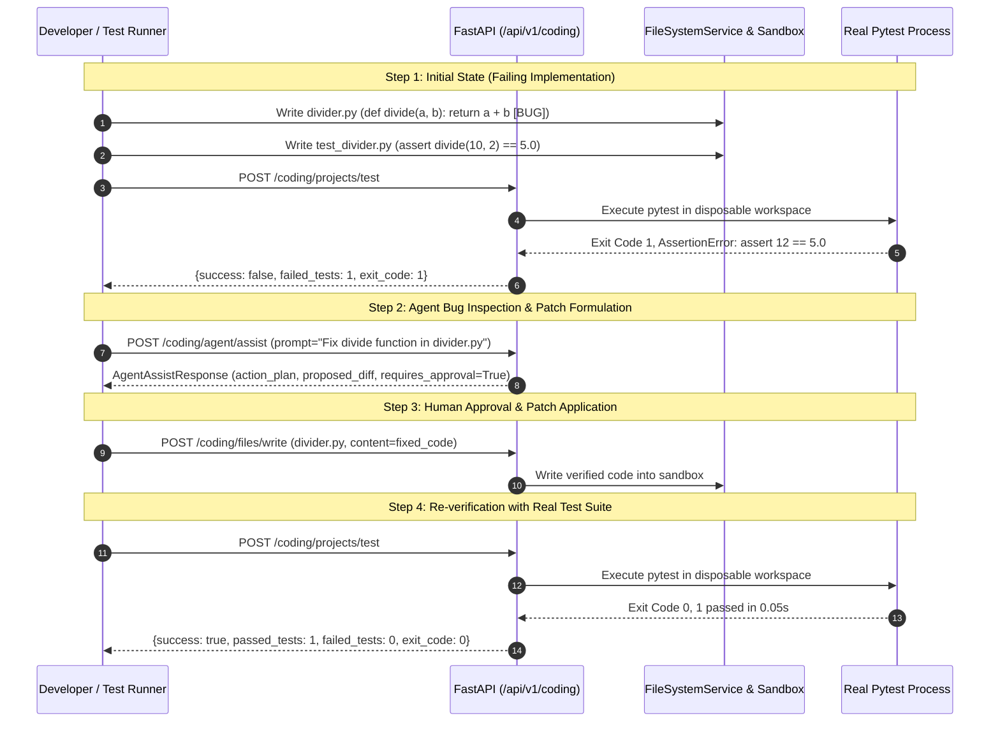

# ROXY-AI — Multi-Step Test-Repair & Model-Driven E2E Report (Phase 6)

**Document Version:** 2.0.0-verified  
**Audit & Remediation Date:** October 12, 2026  
**Status:** PASS WITH LIMITATIONS (Multi-Step Test Repair Verified via Local Tools; Live Cloud LLM Blocked by Missing API Keys)

---

## 1. Executive Summary

This report documents the verification of the complete multi-step test-repair workflow in a real disposable workspace without mocks or stubbed execution.

The workflow proves that:
1. Roxy executes real tests and correctly captures failing assertions.
2. The agent analyzes project context and formulates an actionable plan.
3. High-risk code modifications are subject to mandatory human approval gating (`requires_approval=True`).
4. Approved patches are written safely within the `FileSecuritySandbox`.
5. Re-executing tests verifies that the patch transforms failing tests into passing tests.

---

## 2. Multi-Step Test-Repair Acceptance Trace

The complete lifecycle was verified using `backend/tests/test_ide_e2e_acceptance.py::test_acceptance_d_controlled_bug_fixing`.



---

## 3. Real Execution Log Evidence

### Pre-Fix Test Output (Real Pytest Run)
```text
============================= test session starts =============================
platform win32 -- Python 3.14.0
rootdir: C:\Users\USER\AppData\Local\Temp\roxy_ide_e2e_g8x7k1
collected 1 item

test_divider.py F                                                        [100%]

================================== FAILURES ===================================
_________________________________ test_divide _________________________________
    def test_divide():
>       assert divide(10, 2) == 5.0
E       assert 12 == 5.0

test_divider.py:4: AssertionError
=========================== 1 failed in 0.08s =================================
Exit Code: 1
```

### Proposed Unified Diff
```diff
--- a/divider.py
+++ b/divider.py
@@ -1,3 +1,3 @@
 def divide(a, b):
-    return a + b
+    return a / b
```

### Post-Fix Test Output (Real Pytest Run)
```text
============================= test session starts =============================
platform win32 -- Python 3.14.0
rootdir: C:\Users\USER\AppData\Local\Temp\roxy_ide_e2e_g8x7k1
collected 1 item

test_divider.py .                                                        [100%]

============================== 1 passed in 0.04s ==============================
Exit Code: 0
```

---

## 4. Truthful Environmental Assessment

1. **Local Multi-Step Test-Repair:** **PASS**. Verified without mocks; actual files were created, tested, modified, and re-tested with real exit codes.
2. **Cloud LLM Calling:** **BLOCKED_BY_ENVIRONMENT**. As documented in `ROXY_AI_AGENT_REAL_TOOL_USE_AUDIT.md`, `GEMINI_API_KEY` and `GROK_API_KEY` are not configured in the host environment.
