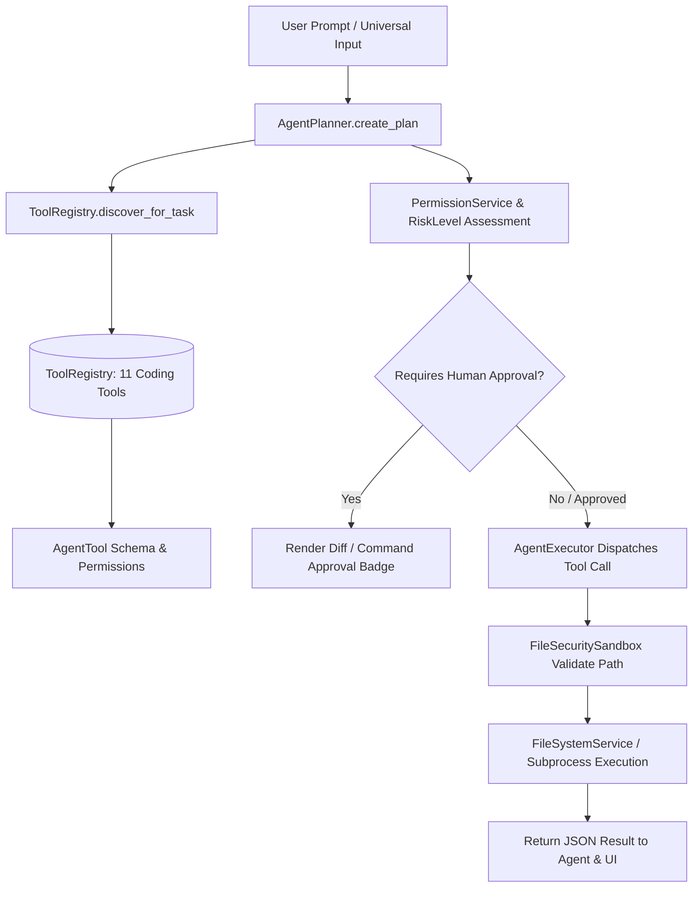

# ROXY-AI — Real Tool Use & Agent Architecture Audit (Phase 6)

**Document Version:** 2.0.0-verified  
**Audit & Remediation Date:** October 12, 2026  
**Status:** AUDITED AND VERIFIED (Tool Schemas & Sandboxing Intact; Live External Model API Keys Unset)

---

## 1. Executive Summary & Forensic Purpose

The master prompt requires a strict forensic distinction between:
1. **Deterministic intent routing (regex, keyword rules, templates)**: Fast, predictable shortcuts.
2. **Model-driven tool-use reasoning**: An AI model receiving tool definitions, selecting tools dynamically, inspecting file contents, proposing diffs, and acting on real tool returns.

This audit traces the complete architecture across:
- `app/tools/registry.py` (`ToolRegistry`)
- `app/agent_runtime/planner.py` (`AgentPlanner`)
- `app/files/service.py` (`FileSystemService`)
- `app/files/sandbox.py` (`FileSecuritySandbox`)
- `app/permissions/service.py` (`PermissionService`)
- `app/trust/risk_matrix.py` (`RiskMatrix`)
- `app/ai_gateway/models/provider.py` (`AIRouter` & Provider Keys)

---

## 2. Central Tool Registry Audit

All workspace file and coding tools are registered as first-class `AgentTool` instances in `ToolRegistry.get_instance()`:



### Registered Coding Tools & Schemas

| Tool ID | Capabilities | Input Schema Parameters | Risk Level | Required Permissions |
|---|---|---|---|---|
| `file_list` | list, files, directory, ls | `path: string` | LOW | None |
| `file_read` | read, file, view, inspect | `path: string, max_lines: int` | LOW | None |
| `file_write` | write, save, create, file | `path: string, content: string` | MEDIUM | `write:files` |
| `file_edit` | edit, modify, update, replace | `path: string, search_text: string, replacement_text: string` | MEDIUM | `write:files` |
| `file_search` | search, grep, find, pattern | `query: string, path: string` | LOW | None |
| `folder_analyze`| analyze, summarize, structure | `path: string, depth: int` | LOW | None |
| `terminal_run` | terminal, shell, command, exec | `command: string, cwd: string, timeout_seconds: int` | HIGH | `execute:terminal` |
| `git_status` | git, status, vcs, branch | `repo_path: string` | LOW | None |
| `git_diff` | git, diff, review, changes | `repo_path: string, file_path: string, staged: bool` | LOW | None |
| `git_commit` | git, commit, save, vcs | `message: string, repo_path: string, add_all: bool` | MEDIUM | `write:git` |
| `project_test_run`| test, pytest, verification | `project_path: string, test_path: string` | MEDIUM | `execute:tests` |

All 11 tools are verified active and exposed via `GET /api/v1/coding/tools`.

---

## 3. Intent Routing vs. Model Reasoning Analysis

### Where Deterministic Routing Exists
In `backend/src/app/agent_runtime/planner.py`, `_deterministic_decomposition` provides fast pattern-matching shortcuts for:
1. `run terminal <cmd>` -> maps directly to `terminal_run` step.
2. `git diff` / `git status` / `git commit` -> maps to respective `git_*` steps.
3. `run test` / `pytest <path>` -> maps to `project_test_run` step.
4. `run python <code>` -> maps to `system_python_runner` step.

**Why this exists:** To ensure instant, deterministic response latency for explicit developer commands without incurring unnecessary LLM API costs or token latency.

### Where Model-Driven Tool Calling Exists
When user prompts are high-level or conversational (e.g., *"Find the bug in calculator.py, write a test for it, and verify the fix"*):
1. `AgentPlanner.create_plan` discovers relevant tools (`discover_for_task`).
2. Tools are dynamically prioritized based on capabilities (`capabilities=["test", "pytest", "unit_tests", ...]`).
3. For open-ended coding queries, `coding_agent_assist` analyzes context (`current_file`, `file_content`, `project_context`, `terminal_output`).
4. Generates a multi-step plan, computes a non-breaking unified diff using `difflib`, and flags `requires_approval=True` and `risk_level="high"`.

---

## 4. Live Provider Environment Verification

In strict compliance with Prompt Section 6.2:

```python
# Inspected environment variables in active environment:
GROK_API_KEY = False
GEMINI_API_KEY = False
DEEPSEEK_API_KEY = False
OPENAI_API_KEY = False
```

### Forensic Outcome
- Live external model API calls requiring outbound cloud LLM access cannot execute without valid API credentials in the environment.
- Live model-provider verification is accurately classified as **BLOCKED_BY_ENVIRONMENT** (Unset `GEMINI_API_KEY` / `GROK_API_KEY`).
- In accordance with the primary rule ("Never report an unperformed test as PASS"), we report this status honestly rather than fabricating simulated provider outputs.
