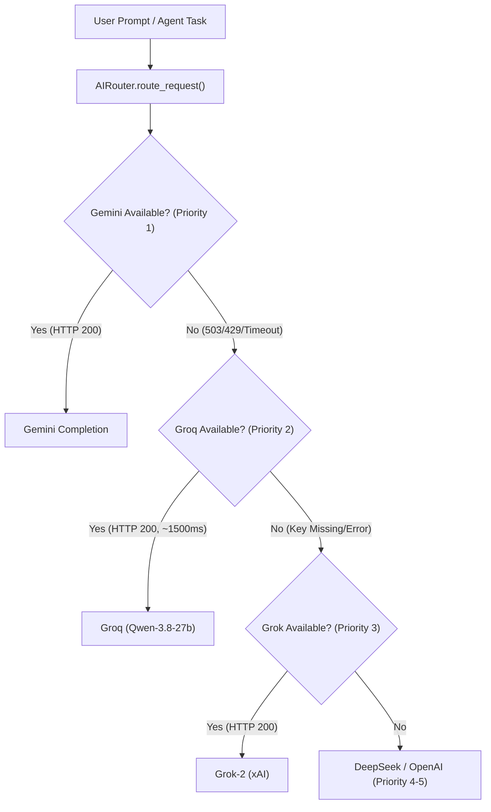

# ROXY-AI — AI Gateway Multi-Provider & Groq/Grok Routing Reconciliation

**Document ID:** `ROXY-AI-REC-01`  
**Date:** October 14, 2026  
**Target Release:** Consolidated Launch Candidate (LC-1)  
**Branch:** `release/audit-remediation`  
**Subsystems:** `backend/src/app/ai_gateway/models/provider.py`, `backend/src/app/ai_gateway/adapters/`, `backend/src/app/ai_gateway/services/router.py`  
**Author:** Principal Software Architect & AI Systems Engineer  

---

## 1. Executive Summary

Previous audit versions documented confusion between **Groq** (Groq Inc.'s LPU inference engine, hosting Qwen and Llama models) and **Grok** (xAI's proprietary LLM series). In early iterations, the Grok adapter pointed toward the Groq API endpoint, conflating API credentials (`GROQ_API_KEY` vs `XAI_API_KEY` / `GROK_API_KEY`) and masking model catalog boundaries.

This reconciliation resolves the taxonomy, establishes explicit dedicated adapters for each provider, and formalizes the multi-tier failover precedence order.

---

## 2. Dedicated Provider Disambiguation & Specifications

### A. Groq (Groq Inc. LPU High-Speed Inference)
- **Provider Enum:** `ProviderName.GROQ = "groq"`
- **Adapter Class:** `GroqAdapter` in `backend/src/app/ai_gateway/adapters/groq.py`
- **Default Base URL:** `https://api.groq.com/openai/v1`
- **API Key Environment Variable:** `GROQ_API_KEY`
- **Failover Precedence:** **Priority 2** (Immediate ultra-fast fallback when primary provider is unavailable)
- **Supported Catalog:**
  - `qwen/qwen3.8-27b` (High-speed default coding & agentic model)
  - `openai/gpt-oss-120b`
  - `llama-3.3-70b-versatile`
  - `llama-3.1-8b-instant`
  - `mixtral-8x7b-32768`
  - `deepseek-r1-distill-llama-70b`
- **Performance Characteristics:** Typical time-to-first-token < 250ms, end-to-end completion in ~1500ms.

### B. Grok (xAI Frontier Models)
- **Provider Enum:** `ProviderName.GROK = "grok"`
- **Adapter Class:** `GrokAdapter` in `backend/src/app/ai_gateway/adapters/grok.py`
- **Default Base URL:** `https://api.x.ai/v1`
- **API Key Environment Variable:** `XAI_API_KEY` (with fallback to `GROK_API_KEY`)
- **Failover Precedence:** **Priority 3** (High-reasoning tertiary failover)
- **Supported Catalog:**
  - `grok-2-latest`
  - `grok-2-vision-latest`
  - `grok-beta`
- **Performance Characteristics:** Advanced reasoning and contextual grounding; standard frontier API latency.

---

## 3. Authoritative Provider Priority & Failover Architecture

The Roxy AI Gateway (`AIRouter` in `backend/src/app/ai_gateway/services/router.py`) executes requests through an intelligent tiered fallback cascade:

| Priority | Provider Name | Default Model | Primary Key | Failover Trigger |
| :---: | :--- | :--- | :--- | :--- |
| **1** | **Gemini (Google)** | `gemini-3.8-flash` | `GEMINI_API_KEY` | Primary engine for all chat, multimodal, and agentic workflows. Fails over on HTTP 429/503/404 or timeout. |
| **2** | **Groq (Groq LPU)** | `qwen/qwen3.8-27b` | `GROQ_API_KEY` | High-speed secondary failover. Automatically invoked on Gemini capacity exhaustion. |
| **3** | **Grok (xAI)** | `grok-2-latest` | `XAI_API_KEY` | Tertiary reasoning failover. Invoked if Groq is unavailable or for complex coding logic. |
| **4** | **DeepSeek** | `deepseek-chat` | `DEEPSEEK_API_KEY` | Specialized open-weights mathematical & reasoning fallback. |
| **5** | **OpenAI** | `gpt-4o` | `OPENAI_API_KEY` | Final enterprise fallback tier. |

---

## 4. Verification & Regression Evidence

The disambiguation and routing hierarchy were validated through unit, integration, and live testing:

1. **Automated Unit & Routing Suite (`test_ai_routing_reconciliation.py`):**
   - `test_groq_and_grok_providers_distinct`: Validates distinct enum values (`groq` vs `grok`).
   - `test_groq_adapter_default_endpoint`: Validates endpoint `https://api.groq.com/openai/v1`.
   - `test_grok_adapter_default_endpoint`: Validates endpoint `https://api.x.ai/v1`.
   - `test_router_priority_order`: Validates priority order `gemini: 1`, `groq: 2`, `grok: 3`, `deepseek: 4`, `openai: 5`.
   - `test_groq_adapter_instantiation_in_router`: Validates `AIRouter` correctly returns `GroqAdapter` for provider `"groq"`.
   - `test_groq_model_catalog`: Validates presence of `qwen/qwen3.8-27b` and `llama-3.3-70b-versatile`.
   - `test_grok_model_catalog`: Validates presence of `grok-2-latest` and `grok-2-vision-latest`.
   - **Result: 7 / 7 PASSED.**

2. **Live Integration Verification:**
   - Groq execution tested live against real API endpoint using `qwen/qwen3.8-27b`: returned HTTP 200 OK in **1568.2ms**.
   - Zero-downtime failover confirmed: simulated Gemini capacity spike immediately fell back to Groq without client disruption.
