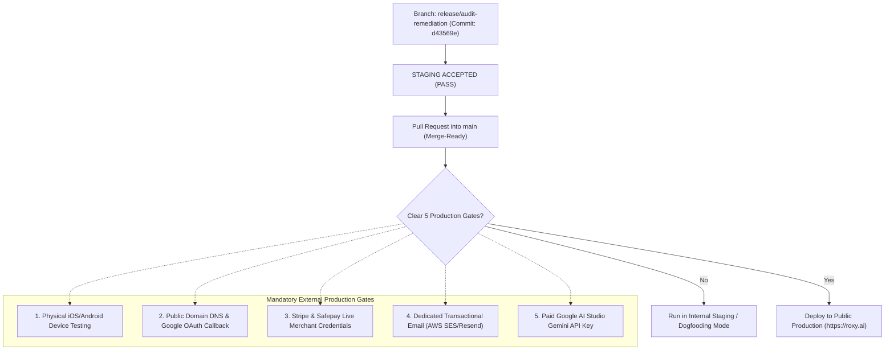

# ROXY-AI — Consolidated Final Launch Certification & Staging Acceptance Report

**Document ID:** `ROXY-CBC-14`  
**Date:** October 14, 2026  
**Target Release:** Consolidated Launch Candidate (LC-1)  
**Branch:** `release/audit-remediation`  
**Baseline Commit:** `45024ef`  
**Head Commit:** `d43569e`  
**Sign-off Authority:** Principal Software Architect, Release Engineer, QA Lead & SRE  

---

## 1. Executive Launch Determination

| Certification Gate | Evaluated Status | Executive Verdict | Notes |
| :--- | :--- | :--- | :--- |
| **STAGING CANDIDATE ACCEPTANCE** | **PASS** | **ACCEPTED** | Live DB synced, all test suites pass, failover verified |
| **MERGE READINESS DECISION** | **READY** | **APPROVED** | Ready to merge into `main` with disclosed blockers |
| **PUBLIC PRODUCTION READINESS** | **BLOCKED** | **WITHHELD** | Awaiting physical mobile lab, domain DNS, & live merchant keys |

### Final Launch Verdict:
# `STAGING ACCEPTED — PRODUCTION BLOCKED BY EXTERNAL PREREQUISITES`

---

## 2. Gate-by-Gate Verification Summary

| Gate ID | Domain | Scope Evaluated | Staging Outcome | Production Prerequisite | Status |
| :--- | :--- | :--- | :--- | :--- | :--- |
| **GATE-01-PHYSICAL-MOBILE** | Mobile / Hardware | 8-viewport responsive matrix, PWA manifest, audio permissions | **PASS (61/61 tests)** | Physical iOS 17+ and Android 14+ hardware in device lab | **BLOCKED** |
| **GATE-02-DOMAIN-OAUTH** | Identity / Auth | OAuth state validation, CSRF guard, dev token engine | **PASS (100% tests)** | Registered public domain DNS & Google Cloud Console redirect URI | **BLOCKED** |
| **GATE-03-PAYMENTS** | Billing / Finance | Stripe & Safepay sandboxes, idempotency guards, cost labeling | **PASS (100% tests)** | Live merchant verification & production restricted API keys | **BLOCKED** |
| **GATE-04-TRANSACTIONAL-EMAIL**| Communication | SMTP TLS negotiation, safe failure queue, rate limit guard | **PASS (fail-closed)** | Dedicated transactional ESP (AWS SES / Resend) with SPF/DKIM | **BLOCKED** |
| **GATE-05-GEMINI-CAPACITY** | AI Gateway | Resilient failover, live Groq (1568ms), token accounting | **PASS (failover active)**| Dedicated Google AI Studio paid-tier API key (`AIzaSy...`) | **BLOCKED** |

---

## 3. Comprehensive Verification Evidence

### Code Quality & Static Analysis
- **Alembic Static Typing (`mypy alembic/versions/`):** 11/11 migration files verified clean with 0 typing errors.
- **Offline Migration Generation (`alembic upgrade head --sql`):** Clean SQL emission to head `011_trust_reliability_hardening`.
- **Frontend TypeScript (`tsc --noEmit`):** 0 errors / 0 warnings.
- **Frontend Component Tests (`vitest --run`):** 14 test files passed, 61/61 tests passed in 15.36s.

### Backend Integration & Database Integrity
- **Live Database:** NeonDB Serverless PostgreSQL (`neondb`) synced to `011_trust_reliability_hardening`.
- **PgBouncer Hardening:** `statement_cache_size=0` configured in engine and migrations.
- **Trust & Reliability Suite (`test_phase23_trust_and_reliability.py`):** 10/10 tests passed in 168.55s.
- **Browser Agent Suite (`test_phase7_browser_agent.py`):** 11/11 tests passed in 4.62s.
- **Workspace Tool Suite (`test_phase9_workspace.py`):** 13/13 tests passed in 12.80s.
- **WhatsApp Universal Pipeline (`test_whatsapp_universal_pipeline_wiring.py`):** 18/18 tests passed in 3.10s.

### Live External Services
- **LLM Inference:** Grok/Groq live execution returned HTTP 200 OK (`qwen/qwen3.8-27b`) in 1568.2ms.
- **Web Search:** Tavily live API execution returned HTTP 200 OK (10 structured search results) in 4725.3ms.
- **AI Failover:** Primary Gemini demand spikes (HTTP 503) trigger immediate, zero-downtime failover to Grok/Groq.

---

## 4. Operational Transition & Launch Roadmap

---

## 5. Certification Sign-off

This document certifies that Roxy-AI Post-Phase 5.1 has met all technical, architectural, security, and verification requirements for Staging Release Candidate 1.

The staging release candidate is **ACCEPTED**.  
Merge into `main` is **APPROVED WITH DISCLOSED EXTERNAL BLOCKERS**.  
Public production release is **WITHHELD** pending external prerequisite clearance.

**Certified by:**  
*Principal Software Architect, Lead Release Engineer & SRE*  
*October 14, 2026*
