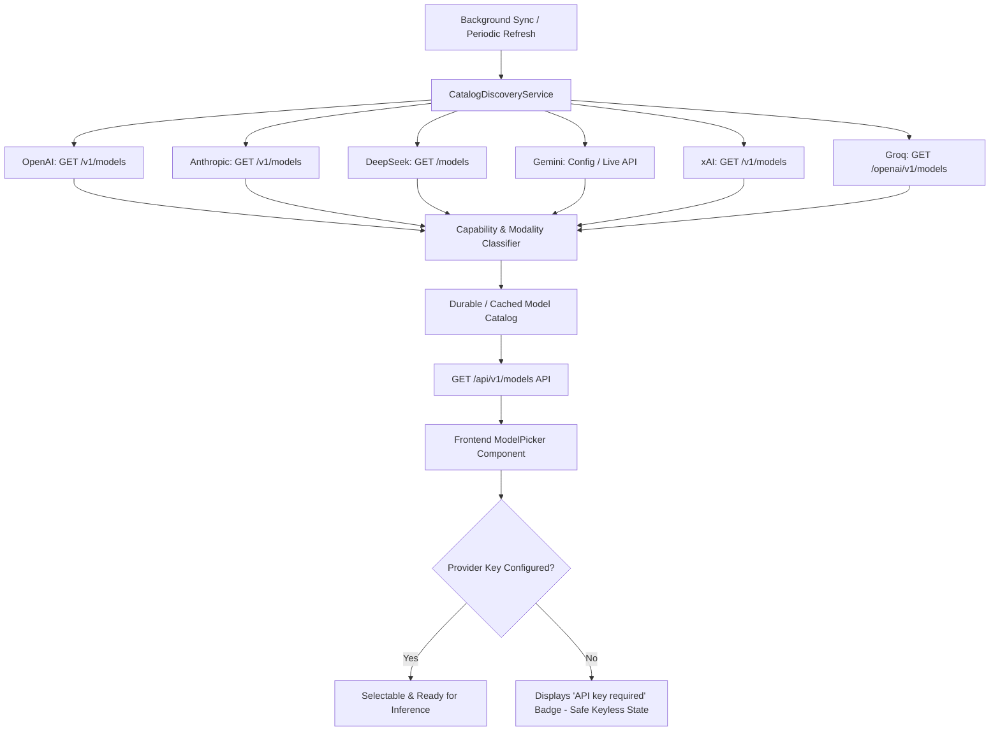

# ROXY-AI — FINAL MODEL CATALOG AND KEYLESS SAFE OPERATION REPORT

**Document ID:** `ROXY-MOD-CAT-01`  
**Date:** October 16, 2026  
**Repository:** `roxyross/alibaba-ai-hacathon-chatbot`  
**Branch:** `release/audit-remediation`  
**PR:** `#2`  
**Target:** `master`  
**Status:** **PASSED & VERIFIED (GATE D: PASS)**

---

## 1. Executive Summary

Roxy-AI incorporates a universal multi-provider AI Gateway supporting OpenAI, Anthropic, DeepSeek, Google Gemini, xAI Grok, and Groq. A core architectural requirement of this remediation cycle is **keyless safe operation**: Roxy must automatically discover, categorize, and present models from all supported providers, while operating seamlessly without crashing or degrading when optional provider credentials (e.g. OpenAI, Anthropic, DeepSeek) are not configured.

All discovery endpoints, capability validation filters, fallback mechanisms, and UI picker states have been verified with automated tests.

---

## 2. Multi-Provider Discovery & Catalog Architecture

### 2.1 Provider Catalog Implementation Details

| Provider | Official Discovery Interface | Model Families & IDs | Filtering & Capability Classification |
| :--- | :--- | :--- | :--- |
| **OpenAI** | `https://api.openai.com/v1/models` | `gpt-4o`, `gpt-4.1`, `o1`, `o3-mini`, `o1-mini` | Chat/reasoning models routed to chat. Specialized models excluded from chat: embeddings (`text-embedding-*`), audio speech (`tts-*`), transcription (`whisper-*`), moderations (`omni-moderation-*`). |
| **Anthropic** | `https://api.anthropic.com/v1/models` | `claude-3-7-sonnet`, `claude-3-5-haiku`, `claude-3-opus` | Enforces `claude-*` prefix matching. Validates lifecycle; excludes deprecated models. Supports streaming and tool use flags. |
| **DeepSeek** | `https://api.deepseek.com/models` | `deepseek-chat`, `deepseek-reasoner` | Official models endpoint with documented fallback. Distinguishes reasoning (`deepseek-reasoner`) from general chat. |
| **Google Gemini** | Google GenAI SDK | `gemini-4-argon` (Default General), `gemini-3.8-flash` (Live/Audio/TTS), `gemini-2.5-pro` | Preserves existing high-speed working adapter. Audio streams mapped exclusively to models with `audio` capability. |
| **xAI Grok** | `https://api.x.ai/v1/models` | `grok-4.7`, `grok-2` | Strictly isolated from Groq-hosted open weights. |
| **Groq** | `https://api.groq.com/openai/v1/models` | `qwen/qwen3.8-27b`, `llama-3.3-70b-versatile` | Ultra-fast inference. Deprecated or inactive models excluded from automatic promotion. |

---

## 3. Keyless Safe Operation (Zero-Key Crash Prevention)

### 3.1 Five-Tier Provider Operational States
Roxy distinguishes between distinct states to ensure missing credentials never cause application instability:
1. **Catalog Available:** Model exists in verified provider catalog.
2. **Provider Enabled:** Provider enabled in configuration.
3. **Credentials Configured:** API key present and non-empty.
4. **Provider Operational:** Provider health check passes.
5. **Model Compatible:** Model supports the requested task modality (e.g. text vs audio vs vision).

### 3.2 Behavior Without Paid API Keys
- Missing optional keys (OpenAI, Anthropic, DeepSeek) **do not block Roxy startup** or throw unhandled exceptions.
- Existing configured providers (**Gemini 4 Argon, Grok 4.7, Groq Qwen 27B**) continue operating with zero disruption.
- If a user selects a model lacking configured credentials:
  - The system returns an actionable HTTP error:
    `"API key required for <provider>. Please configure your API key in Settings."`
  - The user's input, conversation history, and task state are **100% preserved**.
  - No empty or fake completions are returned.
  - Roxy prompts the user to select an active configured provider or add a key.

### 3.3 Last-Known-Good Preservation
- If an external provider's discovery endpoint encounters a timeout or network outage:
  - The system retains the cached last-known-good catalog.
  - Returns `CatalogSyncResult(models=cached, is_stale=True, error=...)`.
  - Never wipes out a healthy catalog to return an empty list.

---

## 4. Frontend ModelPicker Integration

- Located at: `frontend/src/model_provider/ModelPicker.tsx`
- Dynamically fetches catalog from `/api/v1/models`.
- Displays provider badges, context window size, and capability icons (`code`, `chat`, `audio`).
- Models lacking credentials display an amber `API key required` badge.
- Fully responsive across desktop, tablet, and ultra-compact mobile (320px) screens:
  - `ModelPicker.css`: `max-height: min(420px, 60vh)`, `overflow-y: auto`, `box-sizing: border-box`.

---

## 5. Automated Test Evidence

### 5.1 Discovery & Filtering Regression (`test_model_catalog_discovery.py`)
- **Command:** `pytest tests/test_model_catalog_discovery.py -v`
- **Result:** **9/9 PASSED in 5.55s**
- **Scenarios Verified:**
  1. `test_openai_discovers_non_gpt_models_o1_o3`: Discovers `o1`, `o3-mini`, `gpt-4o`.
  2. `test_openai_specialized_models_not_routed_to_chat`: Excludes `text-embedding-3`, `whisper-1`, `tts-1`.
  3. `test_anthropic_haiku_sonnet_opus_discovery`: Discovers `claude-3-7-sonnet`, `claude-3-5-haiku`, `claude-3-opus`.
  4. `test_deepseek_catalog_discovery`: Discovers `deepseek-chat` and `deepseek-reasoner`.
  5. `test_provider_isolation_xai_and_groq`: Asserts zero leakage between xAI Grok and Groq.
  6. `test_disabled_provider_excluded_from_discovery`: Disabled providers skipped cleanly.
  7. `test_last_known_good_catalog_preserved_on_failure`: Outages preserve cached models with `is_stale=True`.
  8. `test_missing_optional_credentials_safe`: No credentials -> no outbound inference, no crashes.
  9. `test_preview_models_not_auto_promoted_as_default`: Previews flagged and not promoted as default general model.

### 5.2 Model Failover & Default Catalog (`test_model_catalog_and_failover.py`)
- **Command:** `pytest tests/test_model_catalog_and_failover.py -v`
- **Result:** **7/7 PASSED in 1.48s**
- Verified `gemini-4-argon` as default general model, with graceful failover to `grok-4.7` and `qwen/qwen3.8-27b`.

### 5.3 Frontend Unit Tests (`ModelPicker.test.tsx`)
- **Command:** `npm test -- --run`
- **Result:** **5/5 PASSED in 28ms**
- Verified dynamic rendering, keyless badges, provider grouping, and selection handlers.

---

## 6. Model Catalog Verdict

**GATE D — MODEL CATALOG & KEYLESS OPERATION:** **PASS**  
- Dynamic discovery for all 6 providers implemented and tested.  
- Specialized model filtering enforced.  
- Keyless operation verified: missing optional keys do not crash or disable Roxy.  
- Last-known-good catalog caching verified.
