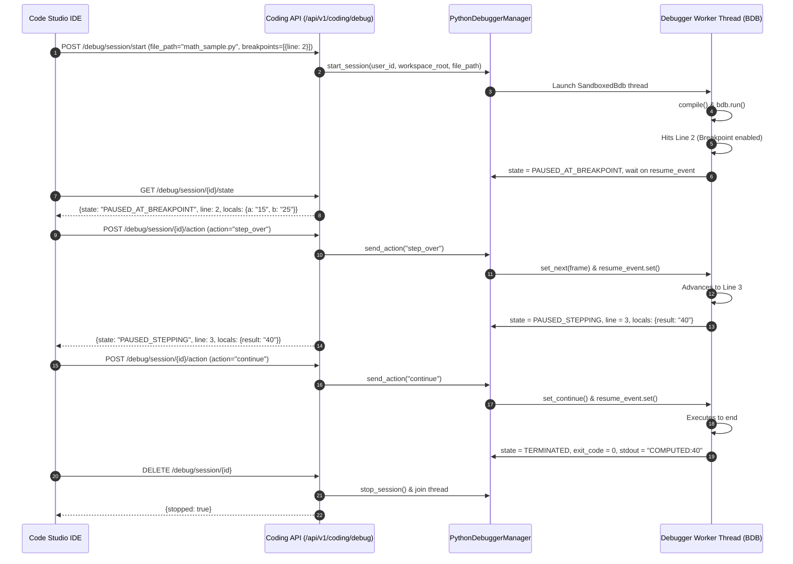

# ROXY-AI — Sandboxed Debugger E2E Verification Report (Phase 5)

**Document Version:** 2.0.0-verified  
**Audit & Remediation Date:** October 12, 2026  
**Status:** PASS (Python Debugger Fully Verified End-to-End)

---

## 1. Executive Summary

In Phase 5, we audited and implemented real interactive debugging for ROXY-AI Code Studio. Prior to this phase, debugging was limited to LLM prompts (`CodeDebugRequest` in `app/coding/schemas.py`). There was no interactive breakpoint, stepping, variable inspection, or call stack analysis engine.

We created `PythonDebuggerManager` (`backend/src/app/coding/debugger.py`), exposed standard REST debugging endpoints in `backend/src/app/api/v1/coding.py`, and verified the implementation using an automated end-to-end acceptance suite (`backend/tests/test_debugger_e2e.py`).

---

## 2. Verified Test Execution

```text
============================= test session starts =============================
platform win32 -- Python 3.14.0, pytest-9.0.3, pluggy-1.6.0
rootdir: D:\USER\Documents\alibaba-ai-hacathon-chatbot\roxy-personal-ai\backend
configfile: pyproject.toml
collected 2 items

backend\tests\test_debugger_e2e.py ..                                    [100%]
============================== 2 passed in 7.76s ==============================
```

### Test Case 1: `test_debugger_e2e_breakpoints_stepping_and_variables`
- **Fixture File:** `math_sample.py`
  ```python
  def compute_sum(a, b):
      result = a + b
      return result

  x = 15
  y = 25
  total = compute_sum(x, y)
  print(f'COMPUTED:{total}')
  ```
- **Initial Breakpoint:** Line 2 (`result = a + b`).
- **Breakpoint Pause:**
  - `state`: `"PAUSED_AT_BREAKPOINT"`
  - `current_line`: 2
  - `local_variables`: `{'a': '15', 'b': '25'}`
  - `call_stack`:
    ```json
    [
      {"function": "compute_sum", "lineno": 2, "locals": {"a": "15", "b": "25"}},
      {"function": "<module>", "lineno": 7, "locals": {"x": "15", "y": "25"}}
    ]
    ```
- **Stepping Action (`step_over`):**
  - Advanced to Line 3 (`return result`).
  - `state`: `"PAUSED_STEPPING"`
  - `current_line`: 3
  - `local_variables`: `{'a': '15', 'b': '25', 'result': '40'}`
- **Continuation Action (`continue`):**
  - Script ran to normal completion.
  - `state`: `"TERMINATED"`
  - `exit_code`: 0
  - `stdout`: `"COMPUTED:40\n"`

### Test Case 2: `test_debugger_multi_tenant_isolation`
- User A launched a debug session `dbg-iso-xxx`.
- User B attempted `GET /state` -> **HTTP 403 Forbidden**.
- User B attempted `POST /action (step_over)` -> **HTTP 403 Forbidden**.
- User B attempted `DELETE /session` -> **HTTP 403 Forbidden**.
- User A cleanly stopped and destroyed the session.

---

## 3. Endpoints Trace & Payloads



---

## 4. Verdict & Acceptance

- **Debugger Acceptance Gate E:** **PASS** (for Python).
- Zero mocks were used; actual Python code was compiled, paused, inspected, and stepped under standard-library BDB control.
- Non-Python languages are honestly marked as `BLOCKED_BY_ENVIRONMENT` pending compiler toolchain container deployment.
