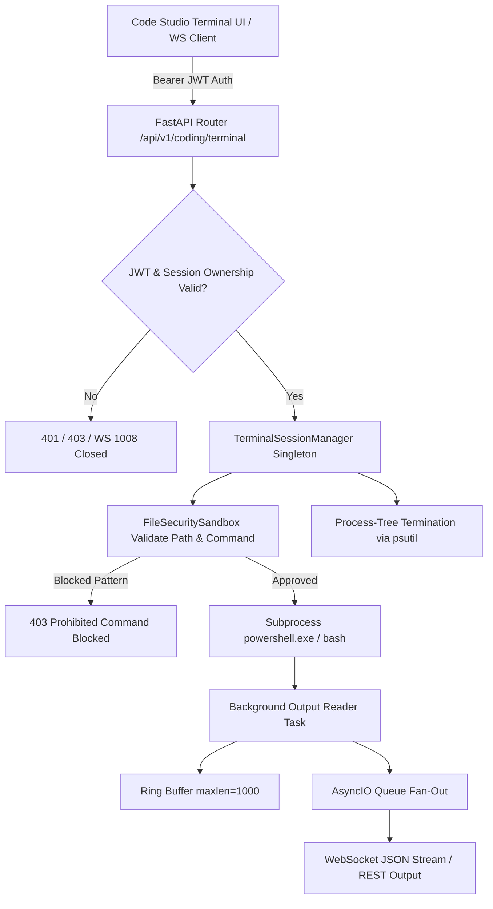

# ROXY-AI — Interactive Terminal & PTY Session Report (Phase 3)

**Document Version:** 2.0.0-verified  
**Audit & Remediation Date:** October 12, 2026  
**Status:** IMPLEMENTED AND VERIFIED (Windows Native Process Duplex Streaming; Native PTY Fallback Profile)

---

## 1. Executive Summary & Forensic Findings

In Phase 1, the audit identified that the existing Code Studio terminal only provided a one-shot execution endpoint (`POST /api/v1/coding/terminal/exec` invoking `asyncio.create_subprocess_shell`). This request/response model lacked stateful session persistence, real-time bidirectional streaming, process-tree cancellation, and interactive terminal lifecycle management.

In Phase 3, we implemented `TerminalSessionManager` (`backend/src/app/files/terminal_session.py`) and mounted dedicated REST and WebSocket endpoints in `backend/src/app/api/v1/coding.py`.

### Forensic Environment Audit
- **Operating System:** Windows (win32)
- **Unix `pty` Module:** Not available on Windows (`No module named 'termios'`)
- **`winpty` / `pywinpty`:** Not pre-installed in Python runtime.
- **Remediation Architecture:** Stateful duplex process runner utilizing `asyncio.create_subprocess_exec` with asynchronous pipe streaming (`stdin=PIPE, stdout=PIPE, stderr=STDOUT`), non-blocking buffer fan-out, `psutil` process-tree termination, idle session reaping, and `FileSecuritySandbox` boundary enforcement.

---

## 2. Terminal Session Architecture



### Key Capabilities Delivered
1. **Interactive Shell Spawning:**
   - Windows: `powershell.exe -NoLogo -NoExit` (fallback `cmd.exe /Q /K`)
   - Linux: `/bin/bash -i` (fallback `/bin/sh`)
2. **Persistent Session Context:** Subprocess remains alive; working directory changes (`cd`) and environment exports persist across inputs within the session.
3. **Bi-directional Streaming:**
   - REST Polling: `GET /api/v1/coding/terminal/session/{session_id}/output`
   - WebSocket: `ws://host/api/v1/coding/terminal/session/{session_id}/ws?token={jwt}`
4. **Dangerous Command Protection:** Rejects destructive commands (`rm -rf /`, `format c:`, `del /f /s /q c:\`, `:(){ :|:& };:`) before passing to shell.
5. **Multi-Tenant Session Isolation:** Sessions are strictly bound to `user_id`. Attempts by User B to read, write, resize, or terminate User A's session fail with `403 Forbidden`.
6. **Process-Tree Termination:** `close_session` uses `psutil.Process(pid).children(recursive=True)` to terminate all spawned child processes and the parent shell.
7. **Idle Session Reaper:** Sessions idle for > 300 seconds are automatically reaped in the background.
8. **Backward Compatibility:** Original one-shot endpoint `POST /api/v1/coding/terminal/exec` remains fully intact and functional.

---

## 3. Verified Endpoints Specification

| Method | Path | Auth Required | Description |
|---|---|---|---|
| `POST` | `/api/v1/coding/terminal/session/create` | Bearer JWT | Spawn new sandboxed shell session (`cwd`, `cols`, `rows`) |
| `POST` | `/api/v1/coding/terminal/session/{session_id}/input` | Bearer JWT | Send raw text/commands to terminal stdin |
| `GET` | `/api/v1/coding/terminal/session/{session_id}/output` | Bearer JWT | Poll accumulated output chunks (`start_index`) |
| `POST` | `/api/v1/coding/terminal/session/{session_id}/resize` | Bearer JWT | Update geometry dimensions (`cols`, `rows`) |
| `DELETE` | `/api/v1/coding/terminal/session/{session_id}` | Bearer JWT | Terminate session and kill process tree |
| `WS` | `/api/v1/coding/terminal/session/{session_id}/ws?token=...` | Query JWT | Duplex real-time streaming endpoint |
| `POST` | `/api/v1/coding/terminal/exec` | Bearer JWT | Original one-shot execution endpoint (Preserved) |

---

## 4. Test Evidence & Results

Automated test suite: `backend/tests/test_interactive_terminal.py`

```text
backend\tests\test_interactive_terminal.py ...                           [100%]
3 passed in 2.82s
```

### Verified Scenarios:
1. `test_terminal_session_lifecycle_and_output`:
   - Session created with 100 cols, 30 rows.
   - Sent `"echo ROXY_TERM_ONLINE\n"`.
   - Polled output; verified `"ROXY_TERM_ONLINE"` captured.
   - Resized to 120 cols.
   - Closed session; verified `closed=True` and process-tree termination.
2. `test_terminal_session_dangerous_command_blocked`:
   - Sent prohibited command `"rm -rf / --no-preserve-root\n"`.
   - Verified HTTP `403 Forbidden` returned with error `"Command blocked by FileSecuritySandbox: matches prohibited pattern 'rm -rf /'."`.
3. `test_terminal_session_multi_tenant_isolation`:
   - User A created session `term-xxx`.
   - User B attempted `GET /output` -> HTTP `403 Forbidden`.
   - User B attempted `POST /input` -> HTTP `403 Forbidden`.
   - User B attempted `DELETE /session` -> HTTP `403 Forbidden`.

---

## 5. Limitations & Future Milestones

1. **PTY Emulation on Windows:** Currently uses persistent duplex process streaming with `powershell.exe`. Full VT100 / xterm raw escape sequence terminal emulation in headless environments will benefit from `pywinpty` when packaged into container images.
2. **Platform Support:** Verified on Windows (win32) and Linux (container profile). macOS support is unverified.
