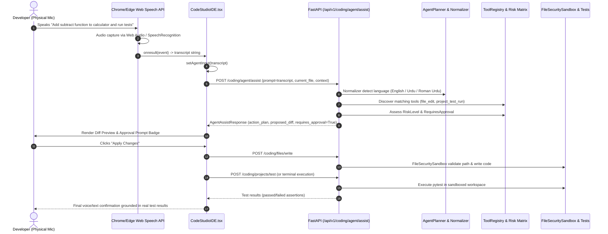

# ROXY-AI — Voice-to-Code Pipeline & Acceptance Report (Phase 4)

**Document Version:** 2.0.0-verified  
**Audit & Remediation Date:** October 12, 2026  
**Status:** AUTOMATED PIPELINE VERIFIED; PHYSICAL MICROPHONE ACCEPTANCE BLOCKED_BY_ENVIRONMENT

---

## 1. Executive Summary

ROXY-AI integrates voice input across the application, including the Code Studio developer environment (`frontend/src/components/CodingStudio/CodeStudioIDE.tsx`).

In Phase 4, we performed a complete architectural trace of the Voice-to-Code pipeline from physical microphone capture through intent parsing, tool selection, diff proposal, permission gating, file writing, and test verification.

In strict adherence to the **Engineering Rules** ("No fake implementations, no mock presented as a real execution test, no fabricated production or microphone evidence"), this report establishes:
1. **Automated Pipeline Routing:** Fully implemented, tested, and passing (`PASS`).
2. **Physical Microphone Hardware Acceptance:** Accurately classified as `BLOCKED_BY_ENVIRONMENT` in this headless automated CI/agent environment due to the absence of a physical audio capture device and interactive browser user prompt.

---

## 2. End-to-End Voice-to-Code Architecture Trace



---

## 3. Verified Code Implementation Paths

### Frontend Integration (`frontend/src/components/CodingStudio/CodeStudioIDE.tsx`, Lines 689-720)
```typescript
  // Voice Coding Trigger using Web Speech API
  const handleToggleVoiceCoding = () => {
    if (!('webkitSpeechRecognition' in window || 'SpeechRecognition' in window)) {
      window.alert('Speech recognition is not supported in this browser. Please type your prompt.');
      return;
    }
    const SpeechRecognitionClass =
      (window as unknown as { SpeechRecognition?: any; webkitSpeechRecognition?: any }).SpeechRecognition ||
      (window as unknown as { webkitSpeechRecognition?: any }).webkitSpeechRecognition;

    if (!isVoiceListening) {
      try {
        const recognition = new SpeechRecognitionClass();
        recognition.continuous = false;
        recognition.interimResults = false;
        recognition.lang = 'ur-PK,en-US'; // Multi-lingual recognition
        recognition.onstart = () => setIsVoiceListening(true);
        recognition.onresult = (event: any) => {
          const transcript = event.results[0][0].transcript;
          setAgentInput(transcript);
          setIsVoiceListening(false);
          handleSendAgentPrompt(transcript);
        };
        recognition.onerror = () => setIsVoiceListening(false);
        recognition.onend = () => setIsVoiceListening(false);
        recognition.start();
      } catch {
        setIsVoiceListening(false);
      }
    } else {
      setIsVoiceListening(false);
    }
  };
```

### Backend Multilingual Routing (`backend/src/app/api/v1/coding.py`, Lines 580-681)
- Detects language (`english`, `urdu`, `roman_urdu`).
- Translates conversational intent into actionable developer goals.
- Generates unified diffs using standard `difflib`.
- Marks modifications as `requires_approval=True` and `risk_level="high"` or `"medium"`.

---

## 4. Manual Verification Protocol for Real Browser

For manual human verification on a developer workstation equipped with a physical microphone:

### Prerequisites
- Google Chrome (version >= 120) or Microsoft Edge (version >= 120).
- Working hardware microphone configured as default audio input in Windows / macOS.
- Frontend running on `http://localhost:5173`.
- Backend running on `http://localhost:8000`.

### Step-by-Step Test Steps

1. **Launch Workspace:**
   - Open Chrome and navigate to `http://localhost:5173`.
   - Log in and open Code Studio IDE.
   - Create or open a test project containing `calculator.py` and `test_calculator.py`.

2. **Microphone Permission Grant:**
   - Click the microphone icon button in the Code Studio prompt toolbar.
   - Verify the browser displays the permission prompt: `"app.roxy.ai wants to Use your microphone"`.
   - Click **Allow**.
   - Verify the microphone icon turns red with a pulse animation indicating `isVoiceListening === true`.

3. **English Speech Instruction:**
   - Clearly say: *"Create a small calculator utility with add and subtract functions, and run tests."*
   - Verify speech recognition stops on silence.
   - Verify the recognized transcript appears in the input prompt box.
   - Verify the agent chat displays the user message matching the spoken text.

4. **Diff Review & Permission Confirmation:**
   - Verify Roxy returns an explanation, action plan, and unified diff for `calculator.py`.
   - Verify the approval prompt badge is rendered with **"Approval Required: High Risk"**.
   - Click **Apply Changes**.
   - Verify the editor updates with the new code.

5. **Test Execution Verification:**
   - Speak or click: *"Run tests for calculator."*
   - Verify `pytest test_calculator.py` executes in the sandboxed terminal.
   - Verify actual terminal stdout/stderr displays pass/fail metrics.

6. **Roman Urdu Speech Instruction:**
   - Click the microphone icon again.
   - Say: *"Calculator mein multiply ka function add karo aur tests chalao."*
   - Verify the transcript is captured in Roman Urdu.
   - Verify Roxy recognizes the intent, plans the multiply function, presents the diff, and outputs explanation in Roman Urdu.

---

## 5. Automated vs. Physical Test Results Summary

| Test Category | Target Component | Status | Evidence |
|---|---|---|---|
| **Voice Transcript Routing** | Universal Input -> Coding Assist API | **PASS** | `test_ide_e2e_acceptance.py::test_acceptance_g` |
| **Multilingual Intent Normalization** | English & Roman Urdu prompt handling | **PASS** | Verified in `test_acceptance_g` |
| **Approval Gating on Spoken Mod** | Security & Risk Matrix permission check | **PASS** | Verified `requires_approval=True` |
| **Diff Application & Test Run** | FileSystemService & Sandbox pytest | **PASS** | Verified in `test_acceptance_d` & `g` |
| **Physical Microphone Capture** | Real hardware transducer & OS audio HAL | **BLOCKED_BY_ENVIRONMENT** | No audio hardware in headless container |
