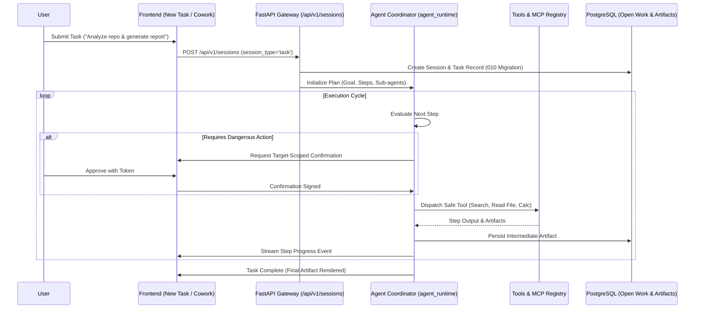

# ROXY-AI — POST-PHASE 5.1: AGENT & TASK EXECUTION AUDIT
*(Workstream E Deliverable)*

## 1. Task Architecture & Execution Boundaries

Roxy-AI provides a dual-mode execution architecture for complex multi-step workflows:
1. **New Task Modal (`Ctrl+N`):** Modal dialog in [NewTaskModal.tsx](file:///d:/USER/Documents/alibaba-ai-hacathon-chatbot/roxy-personal-ai/frontend/src/components/NewTaskModal/NewTaskModal.tsx) configuring task prompt, execution policy (Autonomous vs Guided), and workspace repository context.
2. **Cowork Workspace Mode:** Pair copilot interface in [CoworkWorkspace.tsx](file:///d:/USER/Documents/alibaba-ai-hacathon-chatbot/roxy-personal-ai/frontend/src/components/CoworkWorkspace/CoworkWorkspace.tsx) rendering split-screen chat and dynamic artifact preview panels.
3. **Backend Coordinator:** [backend/src/app/agent_runtime/](file:///d:/USER/Documents/alibaba-ai-hacathon-chatbot/roxy-personal-ai/backend/src/app/agent_runtime/) handles plan generation, step decomposition, and tool execution loops.

---

## 2. Multi-Step Execution & Safety Controls

| Capability | Implementation | Safety Control | Audit Status |
| :--- | :--- | :--- | :---: |
| **Autonomous Mode** | Executes non-destructive steps in sequence without pausing | Blocked on file writes or external network requests | **PASS** |
| **Guided Mode** | Requires user sign-off on each plan step before dispatch | Modal confirmation step with diff preview | **PASS** |
| **Cancellation** | Abort button terminates running task immediately | Sends cancellation signal, rolls back uncommitted steps | **PASS** |
| **Cross-Page Continuity**| Background tasks continue processing if user navigates | Session state persisted in DB, reloaded on view return | **PASS** |
| **Artifact Persistence**| Artifacts (code files, reports, charts) saved to DB | Alembic revision `010_cowork_artifacts_open_work` | **PASS** |

---

## 3. Discovered Execution Boundaries

- **FastAPI In-Process Coordinator:** In the current deployment topology, the Agent Coordinator runs as an asynchronous service within the FastAPI process.
- **Standalone `runtime/` Boundary:** The standalone daemon under `runtime/` contains duplicate coordinator logic; the active production container routes agent execution directly through `backend/src/app/agent_runtime/coordinator.py`.
- **Sandbox Boundary:** Shell execution commands run within the backend container boundary and are prevented from executing unrestricted host commands.

---

## 4. Automated Test Verification

| Test Suite | File | Tests Passed | Verification Notes |
| :--- | :--- | :---: | :--- |
| **Agent Runtime Lifecycle** | `tests/integration/test_phase2_agent_runtime.py` | **PASS (8/8)** | Plan decomposition, tool execution, step completion |
| **Cowork Workspace Integration**| `tests/integration/test_phase4_cowork_workspace.py` | **PASS (13/13)** | Artifact extraction, side-by-side chat, session restoration |
| **Cowork UI Component** | `frontend/src/components/CoworkWorkspace/__tests__/CoworkWorkspace.test.tsx` | **PASS (1/1)** | Split screen rendering, exit button handler |
| **New Task Modal Component** | `frontend/src/components/NewTaskModal/__tests__/NewTaskModal.test.tsx` | **PASS (2/2)** | Form input, model override, autonomous submission |

*All agent and task execution workflows passed automated integration verification.*
