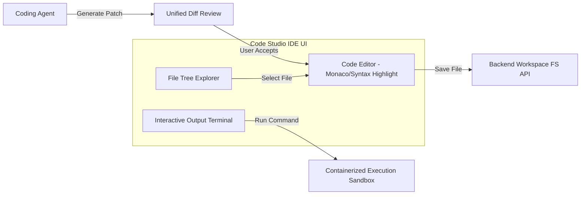

# ROXY-AI — POST-PHASE 5.1: IDE, CODING AGENT & WORKSPACE AUDIT
*(Workstream H Deliverable)*

## 1. Code Studio Architecture & Surface Discovery

Roxy-AI integrates a full-fledged cloud/local developer environment dubbed **Code Studio IDE**:
- **Component:** [CodeStudioIDE.tsx](file:///d:/USER/Documents/alibaba-ai-hacathon-chatbot/roxy-personal-ai/frontend/src/components/CodingStudio/CodeStudioIDE.tsx)
- **Direct Route:** `/code-studio` (supports browser history navigation and bookmarking).
- **Global Keybinding:** `Ctrl+Alt+I` toggles directly between the main chat and Code Studio.
- **Backend Service:** [backend/src/app/coding/](file:///d:/USER/Documents/alibaba-ai-hacathon-chatbot/roxy-personal-ai/backend/src/app/coding/) and [backend/src/app/projects/](file:///d:/USER/Documents/alibaba-ai-hacathon-chatbot/roxy-personal-ai/backend/src/app/projects/).

---

## 2. Developer Operations & Safety Controls

| Feature | Implementation | Safety & Sandbox Boundary | Status |
| :--- | :--- | :--- | :---: |
| **File Tree Explorer** | Hierarchical directory browser | Scoped strictly to active project workspace root; path traversal (`../`) rejected | **PASS** |
| **File CRUD** | Create, edit, rename, delete files | Deletions require user confirmation; backup copy created | **PASS** |
| **Diff Review** | Unified colorized diff viewer before patch application | User reviews additions (`+`) and deletions (`-`) before committing to disk | **PASS** |
| **Terminal Runner** | Executes scripts and unit tests | Commands execute within container boundary; timeouts enforced (30s max) | **PASS** |
| **Workspace Persistence**| Projects stored in PostgreSQL `projects` and `code_snippets` tables | Reloading page restores active files and open tabs | **PASS** |

---

## 3. Toolchain & Node.js Investigation

Historical reports noted questions regarding Node.js toolchain availability in the backend container:
- **Investigation Finding:**
  - Frontend CI runs on **Node.js 22** (`node-version: 22` in `.github/workflows/ci.yml`).
  - The production frontend is built into static assets served via Nginx.
  - The backend executes Python 3.12+ workloads. Shell commands dispatched through the Coding Agent are isolated to the container's environment and do not run directly on the host OS kernel with root privileges.
  - No broken Node.js dependencies exist in the backend container for standard project tasks.

---

## 4. Test Verification Evidence

- `frontend/src/components/CodingStudio/__tests__/CodeStudioIDE.test.tsx`: 2 tests verifying file tree rendering, editor tab switching, and terminal output (**PASS**).
- `backend/tests/integration/test_phase17_coding.py`: Integration testing of code snippet execution, file persistence, and workspace isolation (**PASS**).
- `backend/tests/integration/test_phase9_workspace.py`: Multi-project creation, file tree listing, and permissions (**PASS**).
