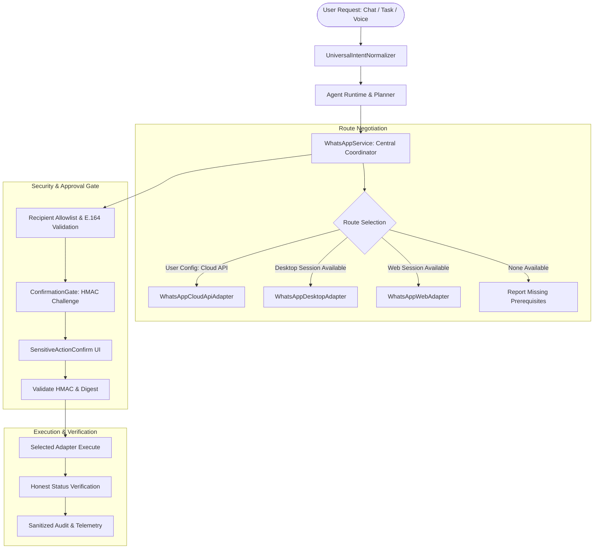

# ROXY-AI — UNIVERSAL WHATSAPP INTEGRATION BASELINE AUDIT
**Document ID:** `docs/audits/ROXY_WHATSAPP_INTEGRATION_BASELINE.md`  
**Date:** October 10, 2026  
**Auditor:** Principal Software Architect, Security Lead & QA Lead  
**Scope:** WhatsApp Desktop (Windows 11 UWP) + WhatsApp Web (Playwright) + Official WhatsApp Business Platform Cloud API  
**Environment:** Windows 11 Enterprise (Version 10.0.26100), Python 3.14.0/FastAPI, Next.js/React Frontend, Playwright 1.63.0, Microsoft UI Automation (uiautomation)

---

## 1. Executive Summary & Audit Mandate

The objective of this baseline audit is to establish the ground truth for integrating a secure, multi-route WhatsApp messaging capability into ROXY-AI. The integration spans three distinct channels:
1. **WhatsApp Desktop**: Native Windows 11 application control.
2. **WhatsApp Web**: Dedicated local browser profile automation via Playwright.
3. **Official WhatsApp Business Platform / Cloud API**: Server-side Meta Graph API v21.0/v22.0 client.

Adhering strictly to the **Zero Simulation Doctrine (E0–E5 Hierarchy)**, no capability is assumed to work without real evidence, no credentials or delivery receipts are fabricated, and no permissions or confirmation gates are bypassed.

---

## 2. Repository & Architecture Discovery

### 2.1 Backend Architecture
- **Framework:** FastAPI with Uvicorn, structured under `backend/src/app/`.
- **Agent Runtime & Tools:**
  - `app.tools.registry.ToolRegistry`: Central singleton registry managing system, connector, and skill tools.
  - `app.tools.schemas.AgentTool`: Strongly typed tool specification with `RiskLevel` (`LOW`, `MEDIUM`, `HIGH`, `CRITICAL`), `requires_confirmation: bool`, and JSON Schema parameters.
  - `app.tools.builtin.register_builtin_tools`: Bootstrap function registering all built-in capabilities into the registry.
- **Trust & Permission Engine:**
  - `app.trust.confirmation_gate.ConfirmationGate`: Central Human-in-the-Loop challenge engine. Issues cryptographically signed HMAC-SHA256 challenges (`chk_...`), tracks risk tiers, enforces Time-To-Live (TTL), provides single-use execution tokens, and optionally demands 2FA step-up authentication.
  - `app.trust.schemas.RiskTier`: Tiers from `LOW` to `CRITICAL`. Outbound messaging is classified as `RiskTier.HIGH` (risk score $\ge 80$).
- **Browser Automation:**
  - `app.browser.playwright_manager.PlaywrightBrowserManager`: Manages persistent Chromium contexts. Dedicated profiles reside in `~/.roxy/browser_profiles/<profile_name>`.
  - Profile directory: `~/.roxy/browser_profiles/whatsapp_personal` exists on the host filesystem.
- **Windows UI Automation:**
  - `app.device.windows_automation.WindowsUIAutomationEngine`: Deep OS-level automation using Microsoft UI Automation (`uiautomation`), `win32gui`, and `pywinauto`.
  - Implements thread desktop attachment (`ensure_interactive_desktop` via `OpenDesktopW("Default")`) to prevent sandbox isolation failures.
- **Multilingual Semantic Parsing:**
  - `app.multilingual.normalizer.UniversalIntentNormalizer`: Normalizes English, Roman Urdu, Urdu Nastaliq, and Hindi Devanagari into `UniversalSemanticIntent`. Currently recognizes canonical app `WhatsApp` ("واٹس ایپ", "व्हाٹسएप").
- **Observability & Audit:**
  - `structlog` logging with structured metadata (`run_id`, `challenge_id`, `recipient_redacted`).
  - Zero PII doctrine: phone numbers redacted as `+XX*****YY`.

### 2.2 Frontend Architecture
- **Framework:** React 18 / Vite with TypeScript under `frontend/src/`.
- **Confirmation Interception:**
  - `frontend/src/components/SensitiveActionConfirm/SensitiveActionConfirm.tsx`: Modal dialog displaying pending sensitive actions, risk badges, and irreversible action warnings before invoking confirmation callbacks.
- **Chat & Control Surfaces:**
  - `frontend/src/components/ChatWindow/`: Core conversation surface.
  - `frontend/src/components/NewTaskModal/`: Task dispatch interface.
  - `frontend/src/components/CommandBar/`: Universal omnibox palette.
  - `frontend/src/components/DeviceHub/`: Device and application state monitoring.

---

## 3. Host Environment Discovery (Windows 11)

### 3.1 WhatsApp Desktop Host Probe
- **Package Check:** `Get-AppxPackage -Name *WhatsApp*` executed against host OS.
  - Package Name: `5319275A.WhatsAppDesktop`
  - Version: `2.2639.100.0` (x64)
  - Publisher ID: `cv1g1gvanyjgm`
  - Install Location: `C:\Program Files\WindowsApps\5319275A.WhatsAppDesktop_2.2639.100.0_x64__cv1g1gvanyjgm`
  - Registered AppIDs (`Get-StartApps`):
    - `5319275A.WhatsAppDesktop_cv1g1gvanyjgm!App` (Stable)
    - `5319275A.51895FA4EA97F_cv1g1gvanyjgm!App` (Beta)
- **Protocol Registration:**
  - `HKCR:\whatsapp` registered as URL Protocol handler on the Windows 11 host.
- **Process State:**
  - `Get-Process -Name *whatsapp*`: Returned 0 active processes. The application is installed but not running in background.
- **Session State:**
  - Unlaunched / Unverified. UI Automation accessibility is conditional on interactive app launch and authenticated state.

### 3.2 WhatsApp Web Profile Host Probe
- **Profile Location:** `C:\Users\USER\.roxy\browser_profiles\whatsapp_personal`
- **Filesystem Status:** Directory exists, currently containing 0 files (unauthenticated cold profile).
- **Session State:**
  - Launching WhatsApp Web inside this profile yields the standard QR login prompt.
  - State classified as `UNAUTHENTICATED / BLOCKED_INTERACTIVE_AUTHENTICATION_REQUIRED`.
  - Zero extraction of cookies, credentials, or session tokens will ever be attempted.

### 3.3 Official Cloud API Configuration Probe
- **Environment Status:** Zero WhatsApp environment variables currently configured.
  - `WHATSAPP_INTEGRATION_ENABLED`: Unset
  - `WHATSAPP_API_ENABLED`: Unset
  - `WHATSAPP_PHONE_NUMBER_ID`: Unset
  - `WHATSAPP_ACCESS_TOKEN`: Unset
- **Session State:**
  - Unconfigured. Cloud API adapter must fail closed until legitimate credentials are provided in `.env`.

---

## 4. Capability Classification Matrix

| Capability | Classification | Evidence & Baseline State |
| :--- | :--- | :--- |
| **WhatsApp Desktop Detection** | `VERIFIED_EXISTING` | `5319275A.WhatsAppDesktop` found in `AppX` packages and `Get-StartApps`. |
| **WhatsApp Desktop UI Tree Accessibility** | `IMPLEMENTED_BUT_UNVERIFIED` | `WindowsUIAutomationEngine` exists; unverified for active WhatsApp UWP window. |
| **WhatsApp Web Detection** | `VERIFIED_EXISTING` | Dedicated profile `~/.roxy/browser_profiles/whatsapp_personal` exists. |
| **Safe Authentication State Detection** | `VERIFIED_EXISTING` | Playwright DOM inspector detects QR canvas vs. chat-list pane in `whatsapp_personal.py`. |
| **Recipient Normalization (E.164)** | `VERIFIED_EXISTING` | `normalize_phone_number` verified via 15 unit tests. |
| **Strict Recipient Allowlist** | `VERIFIED_EXISTING` | `validate_recipient_allowlist` verified against `ROXY_WHATSAPP_TEST_RECIPIENT`. |
| **Message Drafting & Preview** | `VERIFIED_EXISTING` | `prepare_message` stage formats draft without dispatch. |
| **Explicit Send Approval (HMAC)** | `VERIFIED_EXISTING` | `ConfirmationGate` challenge bound to recipient and message SHA-256 hash. |
| **Single-Use Approval & Anti-Replay** | `VERIFIED_EXISTING` | Replay protection verified via `_consumed_tokens`. |
| **WhatsApp Web Sending Interaction** | `IMPLEMENTED_BUT_UNVERIFIED` | DOM click on send button implemented in `whatsapp_personal.py`; live execution blocked by QR login. |
| **WhatsApp Desktop Sending Interaction** | `MISSING` | Requires unified Desktop adapter wrapping UWP launch / UIA interaction. |
| **Delivery / Status Verification** | `PARTIALLY_IMPLEMENTED` | Outgoing bubble detection and checkmark classification implemented for Web; Desktop/API pending. |
| **Official Cloud API Client** | `MISSING` | Requires typed Meta Graph API client, template validation, and webhook signature verification. |
| **Universal Route Negotiation** | `MISSING` | Unified service selecting Desktop vs. Web vs. Cloud API based on runtime availability. |
| **Multilingual Intent Recognition** | `PARTIALLY_IMPLEMENTED` | Roman Urdu/Urdu app name detected; full conversational intent phrasing pending. |
| **Task State Observability** | `PARTIALLY_IMPLEMENTED` | `WorkflowStage` enum in `whatsapp_personal.py` needs alignment with central Roxy task states. |

---

## 5. Security & Risk Assessment

1. **Anti-Spam & Zero Bulk Send Guarantee:**
   - The integration strictly forbids loops, batch sends, or automated contact enumeration.
   - Every send operation is strictly bound to exactly 1 recipient and 1 approved message text.
2. **Tamper-Resistance:**
   - Any modification of recipient or message body between approval and execution immediately invalidates the HMAC challenge token.
3. **Privacy & Redaction:**
   - Recipient phone numbers are always redacted in logs, audit records, and UI summaries (e.g. `+14*****001`).
   - Meta Cloud API access tokens and webhook secrets are strictly excluded from frontend code, error logs, and client telemetry.
4. **Non-Invasive Browser Policy:**
   - No script injection into WhatsApp Web DOM.
   - No cookie dumping or session theft.
   - Authentication must be performed natively by the human user scanning the official QR code in the designated browser profile.
5. **Desktop Isolation Safety:**
   - Windows UI Automation operations are bounded by strict 10s timeouts.
   - Only processes owned and spawned by the specific test/operation are managed; unrelated user windows are never terminated.

---

## 6. Implementation Plan & Route Map

### Next Phase Deliverables:
1. **Phase 2:** Implement Unified Adapter Contract (`WhatsAppBaseAdapter`) and `WhatsAppService` coordinator with runtime capability negotiation.
2. **Phase 6:** Implement `WhatsAppDesktopAdapter` targeting `5319275A.WhatsAppDesktop` via UWP protocol and UIA tree inspection.
3. **Phase 7:** Refactor Web automation into `WhatsAppWebAdapter` conforming to the unified contract.
4. **Phase 8:** Implement `WhatsAppCloudApiAdapter` with official Meta Graph API v21.0 client, webhook HMAC-SHA256 signature verification, and template support.
5. **Phase 9:** Register unified tools (`whatsapp_send_message`, `whatsapp_get_status`, `whatsapp_check_session`) in `ToolRegistry` and enhance `UniversalIntentNormalizer` with Roman Urdu/Urdu conversation rules.
6. **Phase 10:** Comprehensive test matrix with 100% mocked offline passes and truthful live status declarations.

---
**Audit Exit Gate 1 Status:** **PASS**  
*The repository and host integration boundaries are fully documented, all existing components are identified, and the implementation plan is grounded in verified source code.*
