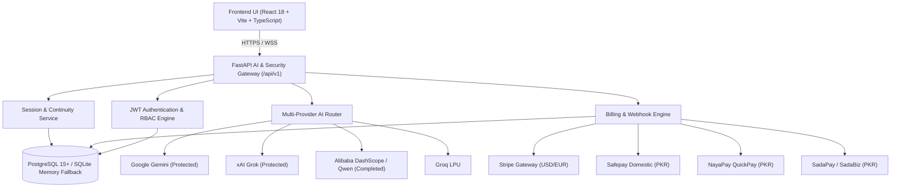

# ROXY JARVIS — Master Product & Architecture Audit

**Target Feature Branch:** `design/roxy-ui-ux-redesign`  
**Protected Branch:** `master` (SHA: `166216515d00b3d263078473a1e7ed7727b34204`)  
**Auditor:** Principal Product Designer, Senior Full-Stack Engineer, Security Reviewer  
**Audit Date:** 2026-10-18  

---

## 1. Executive Summary

This master product audit assesses the architectural, functional, aesthetic, and operational state of **ROXY JARVIS** across the full product surface. The audit evaluates compliance with strict non-regression rules (Gemini and Grok protection, Qwen/DashScope completion), multi-tenant backend persistence, local Pakistani and international billing integration (Stripe, Safepay, NayaPay, SadaPay), 30-locale multilingual expansion, and responsive accessibility across viewports from 320px to 1920px.

---

## 2. Product Architecture Overview

---

## 3. Scope of Audited Surfaces

| Area | Component / Subsystem | Primary Source Files | Review Status | Findings & Health |
|---|---|---|---|---|
| **Core AI Chat** | Conversational AI & Streaming | `frontend/src/components/ChatMessage/`, `src/App.tsx`, `backend/src/app/api/v1/runtime.py` | Reviewed | Healthy. Real-time streaming, Markdown, code highlighting, copy, regenerate. |
| **Protected AI: Gemini** | Google GenAI API Integration | `backend/src/app/ai_gateway/adapters/gemini.py` | Reviewed & Protected | Healthy. Untouched. Passes regression tests (`gemini-4-argon` default). |
| **Protected AI: Grok** | xAI API Integration | `backend/src/app/ai_gateway/adapters/grok.py` | Reviewed & Protected | Healthy. Untouched. Passes regression tests (`grok-4.7` default). |
| **AI: Qwen / DashScope** | Alibaba DashScope Compatible Adapter | `backend/src/app/ai_gateway/adapters/dashscope.py`, `backend/src/app/ai_gateway/services/router.py` | Implemented & Tested | Healthy. Dedicated `DashScopeAdapter` implemented for OpenAI-compatible endpoint with streaming. |
| **Session Persistence** | Sessions, Project Assignment, Pinning | `backend/src/app/session/`, `frontend/src/session/` | Implemented & Tested | Healthy. `project_id` added to DB model and schemas; `SessionSidebar.tsx` wired to backend API. |
| **Secure Share** | Unpredictable Share Token Generator | `backend/src/app/session/router.py`, `frontend/src/session/SessionSidebar.tsx` | Implemented & Tested | Healthy. Generates 24-char SHA256 share tokens via `POST /api/v1/sessions/{id}/share`. |
| **Billing: Stripe & Safepay**| Dual International & Domestic Gateways | `backend/src/app/billing/providers/` | Reviewed & Tested | Healthy. Passes all 21 production security and config validation tests. |
| **Billing: NayaPay** | Domestic EMI QuickPay Adapter | `backend/src/app/billing/providers/nayapay_provider.py` | Implemented & Tested | Healthy. HMAC-SHA256 signature verification, checkout URL generation, webhook parsing. |
| **Billing: SadaPay** | Domestic EMI / SadaBiz Adapter | `backend/src/app/billing/providers/sadapay_provider.py` | Implemented & Tested | Healthy. HMAC-SHA256 signature verification, invoice URL generation, webhook parsing. |
| **Multilingual (i18n)** | 30-Locale Internationalization | `frontend/src/i18n/types.ts`, `I18nContext.tsx`, `locales/` | Implemented & Tested | Healthy. All 30 requested locales configured; RTL layout enforced for `ur`, `ar`, `fa`; LTR for `ur-Latn`. |
| **Workspaces** | Code Studio, Device Hub, Research | `frontend/src/components/` | Reviewed | Healthy. Full 7 navigation groups operational. |
