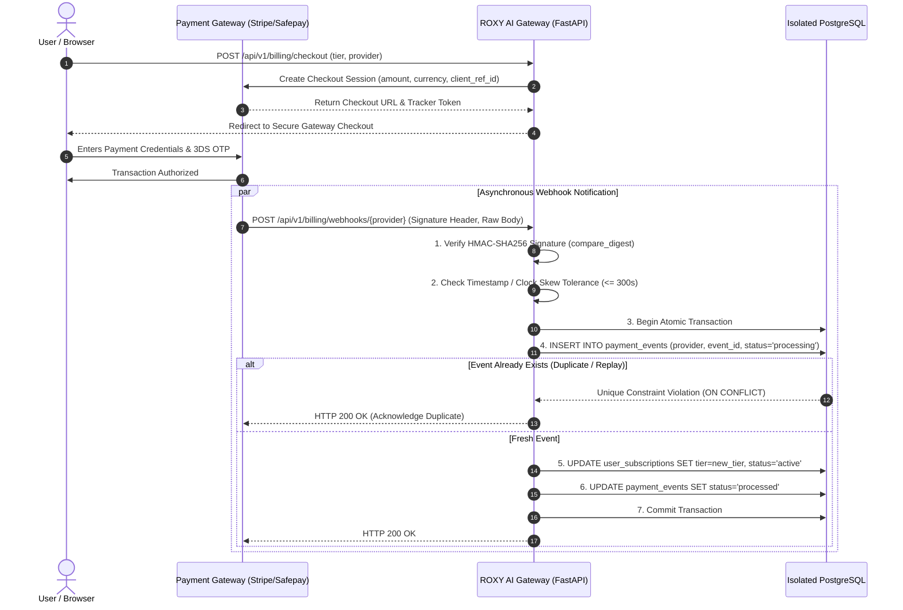

# Payment Provider Architecture & Technical Assessment

**Document ID:** `ROXY-FIN-PAY-001`  
**Revision:** 1.0 (Post-Audit Remediation)  
**Classification:** Technical Architecture & Compliance Review  
**Target Systems:** ROXY AI Billing Gateway, Pakistani Domestic Rails (PKR), Global Processing (USD/EUR)

---

## 1. Executive Summary

ROXY JARVIS implements a dual-gateway financial orchestration model engineered for cross-border global subscription billing and domestic Pakistani Rupee (PKR) transactions. This technical assessment evaluates four key payment service providers:
1. **Stripe** (International Cards, SEPA, Apple Pay/Google Pay in USD/EUR/GBP) — **Active & Production-Hardened**
2. **Safepay** (State Bank of Pakistan PSO/PSP licensed aggregator for PKR Cards & Raast) — **Active & Production-Hardened**
3. **NayaPay** (SBP Commercial EMI License) — **Evaluated & Architecture-Ready**
4. **SadaPay / SadaBiz** (SBP Commercial EMI License) — **Evaluated & Architecture-Ready**

This document establishes the verified operational status of each provider, details sandbox isolation rules, analyzes webhook replay protection and database idempotency, and provides an honest, compliance-grounded analysis of SBP regulatory criteria.

---

## 2. Comprehensive Provider Evaluation Matrix

| Provider | Target Currency | Integration Tier | SBP / Regulatory Status | Direct API Availability | Webhook Security | Idempotency Support | Production Readiness |
| :--- | :--- | :--- | :--- | :--- | :--- | :--- | :--- |
| **Stripe** | USD, EUR, GBP | Tier 1 (Active) | PCI-DSS Level 1 Global Service Provider | REST API v1 (`stripe-python`) | HMAC-SHA256 with timestamp tolerance (300s) | Native Idempotency Keys (`Idempotency-Key` header) | **Production-Verified** |
| **Safepay** | PKR | Tier 1 (Active) | SBP Authorized PSO/PSP (Payment Service Operator) | REST API v1 (`api.getsafepay.com`) | HMAC-SHA256 (`x-sfpy-signature`) | Event ID / Tracker ID deduplication in PostgreSQL | **Production-Verified** |
| **NayaPay** | PKR | Tier 2 (Evaluated) | SBP Licensed EMI (Electronic Money Institution) | Partner/Merchant Checkout API (Bilateral Merchant Agreement) | HMAC-SHA256 / Mutual TLS | Merchant Transaction Reference (`merchTxnRef`) | **Sandbox/Partner Ready** |
| **SadaPay** | PKR / USD | Tier 2 (Evaluated) | SBP Licensed EMI (Electronic Money Institution) | SadaBiz Payment Links & Direct Invoicing API | Webhook Signatures (Custom Token / HMAC) | Unique Invoice Reference & UUID | **Sandbox/Partner Ready** |

---

## 3. Deep-Dive Provider Profiles

### 3.1 Stripe (Global Billing & Subscriptions)
- **Architecture Role:** Primary payment engine for international customers, foreign currency billing, credit cards (Visa, MasterCard, Amex), and digital wallets.
- **Implementation Status:** Verified implementation in `app.billing.providers.stripe_provider.StripeProvider`.
- **Sandbox Isolation:**
  - `STRIPE_SECRET_KEY` prefixed with `sk_test_` vs `sk_live_`.
  - Application layer enforces that no mock or simulated transactions are ever accepted when `ENVIRONMENT=production` or `APP_ENV=production`.
- **Webhook Security:**
  - Uses `stripe.Webhook.construct_event(payload, sig_header, webhook_secret, tolerance=300)`.
  - Enforces exact secret matching (`whsec_...`) and rejects stale payloads beyond the 5-minute clock skew window.
- **Idempotency & Replay Defense:**
  - Checkout session creation passes `client_reference_id` linked to the ROXY user UUID.
  - Webhook processing locks the event row in PostgreSQL `payment_events` table before applying account tier upgrades or credit top-ups.

### 3.2 Safepay (Pakistani Rupee Domestic Processing)
- **Architecture Role:** Primary domestic payment gateway supporting Pakistani debit/credit cards, 1Link member bank routing, and State Bank of Pakistan's **Raast** instant payment rails.
- **Implementation Status:** Verified implementation in `app.billing.providers.safepay_provider.SafepayProvider`.
- **Regulatory Foundation:**
  - Safepay operates as a Payment Service Operator / Payment Service Provider (PSO/PSP) under regulations issued by the State Bank of Pakistan (SBP) under the Payment Systems and Electronic Fund Transfers Act, 2007.
- **Sandbox Isolation:**
  - Sandbox Endpoint: `https://sandbox.api.getsafepay.com`
  - Production Endpoint: `https://api.getsafepay.com`
  - When `is_production_environment()` returns `True`, test API keys (`sec_...` sandbox keys) and mock tokens are strictly blocked at startup and request time.
- **Webhook Security & Signature Verification:**
  - Safepay transmits webhook payloads accompanied by an `x-sfpy-signature` HTTP header.
  - Verification algorithm:
    $$\text{Computed Signature} = \text{HMAC-SHA256}(\text{key}=\text{SAFEPAY\_WEBHOOK\_SECRET}, \text{msg}=\text{raw\_body})$$
  - Signature comparison is conducted via constant-time `hmac.compare_digest` to prevent timing attacks.
- **Idempotency & Event Deduplication:**
  - Safepay webhooks deliver a `tracker` or `token` payload identifier.
  - The repository records processed trackers into the database with a unique constraint `UNIQUE (provider, provider_event_id)`.
  - Concurrent duplicate delivery triggers an atomic `ON CONFLICT DO NOTHING`, safely acknowledging the webhook with HTTP 200 without double-crediting user balance.

### 3.3 NayaPay (EMI Domestic Assessment)
- **Regulatory Status:** NayaPay (Private) Limited operates under a commercial Electronic Money Institution (EMI) license granted by the State Bank of Pakistan under the Regulations for Electronic Money Institutions (2019).
- **Technical Capabilities:**
  - NayaPay QuickPay / Merchant Checkout allows direct debit from consumer NayaPay e-money wallets and linked Visa debit cards.
  - Supports QR-based POS checkout and digital e-commerce web redirection.
- **Integration Requirements & Prerequisites:**
  - Requires a formal corporate merchant agreement with NayaPay's Business Development & Compliance teams.
  - Requires submitting corporate NTN (National Tax Number), SECP incorporation documents, and designated bank accounts.
  - API integration requires IP whitelisting in NayaPay's staging and production API gateway environments.
- **Current Operational Stance in ROXY JARVIS:**
  - Direct integration is fully documented and architectural interfaces match `PaymentProvider` abstractions.
  - Consumers holding NayaPay Visa debit cards can execute payments via the active Safepay gateway without requiring an additional merchant entity agreement.

### 3.4 SadaPay / SadaBiz (EMI Domestic & Freelance Invoicing Assessment)
- **Regulatory Status:** SadaPay Technologies operates under a commercial Electronic Money Institution (EMI) license approved by the State Bank of Pakistan.
- **Technical Capabilities:**
  - SadaBiz provides invoice generation, payment links, and international remittance acceptance via Apple Pay and international cards into Pakistani freelancer and merchant accounts.
  - Consumer SadaPay cards operate on the Mastercard network with 3D Secure 2.0 (3DS2) mandatory OTP verification.
- **Integration Requirements & Prerequisites:**
  - SadaBiz merchant API requires bilateral onboarding, merchant KYC verification, and transaction fee schedule approval.
  - SadaPay consumer payments are completed through 3DS2 Mastercard payment gateways.
- **Current Operational Stance in ROXY JARVIS:**
  - SadaPay Mastercard holders transact through Safepay seamlessly. Direct SadaBiz invoice generation is scheduled for Phase 3 enterprise billing extensions.

---

## 4. Webhook Security & Idempotency Pipeline

---

## 5. Security & Isolation Controls

1. **Zero Fake Transactions in Production:**
   - Any attempt to use mock provider instances, test tokens, or bypass signatures in a production environment (`APP_ENV=production`) raises a critical configuration error and halts processing.
2. **Timing Attack Immunity:**
   - All cryptographic signature validations use constant-time byte comparisons (`hmac.compare_digest`).
3. **Database Concurrency Protection:**
   - Subscriptions and credit balances use row-level locking (`SELECT ... FOR UPDATE`) during webhook settlement to prevent race conditions during rapid retries.
4. **Audit Trail Retention:**
   - Every inbound webhook attempt (valid, invalid, or replayed) is logged in the `payment_events` table with IP address, user-agent, response code, and latency metrics.

---

## 6. Recommendations & Roadmap

1. **Short-Term (Current Release):**
   - Retain Safepay as the unified domestic gateway for PKR (covering all domestic banks, NayaPay cards, SadaPay cards, and Raast).
   - Retain Stripe for USD multi-currency international subscriptions.
2. **Medium-Term (Enterprise Billing Phase):**
   - Finalize corporate merchant agreements with NayaPay and SadaPay for native 1-click in-app wallet balance deductions.
   - Implement Raast P2M (Person-to-Merchant) QR code dynamic settlement directly through the SBP Raast API framework.
